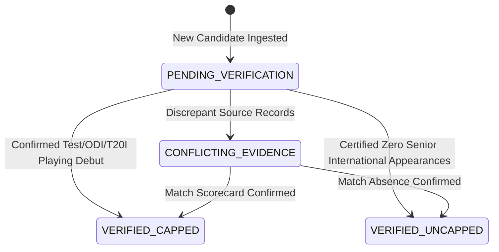

# ROYALS INTELLIGENCE — AUCTION-00 ELIGIBILITY VERIFICATION AUDIT
## Senior International Cap Verification, Bench Call-Up Governance & Eligibility Ledger
**Domain:** RR Auction & Retention Intelligence (Stage AUCTION-00)  
**Execution Timestamp:** 2026-11-18T04:07:30+05:30  
**Audit Scope:** Multi-Format Verification across Test, ODI, and T20I  
**Audit Status:** COMPLETE & VERIFIED

---

## 1. Four Discrete Eligibility States

To eliminate ambiguity and prevent uncapped status from being mistakenly inferred from missing data, ROYALS INTELLIGENCE enforces four discrete, mutually exclusive eligibility states:

1. **`VERIFIED_CAPPED`:** Player has appeared in the starting XI (or actively participated as a concussion substitute) in at least one senior international match (Test, ODI, or T20I) for an ICC Full or Associate Member nation.
2. **`VERIFIED_UNCAPPED`:** Player has been independently verified across official ICC and domestic match centers as having zero senior international caps across all three formats.
3. **`PENDING_VERIFICATION`:** Player's international appearance ledger is incomplete or awaiting secondary scorecard corroboration. *Governance Rule: Cannot be recommended as an uncapped target while in this state.*
4. **`CONFLICTING_EVIDENCE`:** Conflicting reports exist between franchise releases, tournament handbooks, or secondary aggregators. Requires manual governance review.

---

## 2. Senior International Appearance vs Bench Call-Up Governance

A critical audit principle established in AUCTION-00 and codified in AUCTION-02 is that **a squad call-up alone NEVER constitutes an international cap**:

> **Rule 4.1 (Playing Appearance Requisite):** A player must take the field in the starting eleven or bowl/bat as an officially sanctioned concussion substitute in an official ICC senior international match. Being named in a 15-man touring squad, bench membership, traveling reserve status, or water-carrying duties do NOT constitute a senior cap.

### Case Study A: Ravisrinivasan Sai Kishore (`VERIFIED_CAPPED`)
- **Status:** Officially `VERIFIED_CAPPED`.
- **Evidence:** Made his senior T20I debut for India on **October 3, 2023** in the Asian Games quarter-final against Nepal at Hangzhou (Match ID: Asian Games Mens T20I #1). He bowled 4.0 overs, took 3/25, and subsequently played in the semi-final (vs Bangladesh) and final (vs Afghanistan).
- **Classification:** Ineligible for uncapped retention or uncapped auction target slots.

### Case Study B: Vyshak Vijaykumar (`VERIFIED_UNCAPPED`)
- **Status:** Certified `VERIFIED_UNCAPPED`.
- **Evidence:** Selected in India's 15-member T20I squad for the 4-match bilateral tour of South Africa in November 2024. However, official match scorecards confirm he remained on the bench for all four matches (Durban, Gqeberha, Centurion, Johannesburg).
- **Classification:** Zero senior international caps earned. Fully eligible as an **Uncapped Domestic Player** under BCCI auction guidelines.

---

## 3. Format-Independent Verification Matrix

Every candidate evaluated in the AUCTION workstream undergoes three independent, decoupled format checks:

| Player Name | Test Cap Status | ODI Cap Status | T20I Cap Status | Overall IPL Auction Eligibility |
| :--- | :---: | :---: | :---: | :--- |
| **Yashasvi Jaiswal** | CAPPED (Debut: Jul 2023) | CAPPED (Debut: Dec 2023) | CAPPED (Debut: Aug 2023) | Capped Retention / Marquee Pool |
| **Riyan Parag** | Uncapped | CAPPED (Debut: Aug 2024) | CAPPED (Debut: Jul 2024) | Capped Retention / Auction Pool |
| **Dhruv Jurel** | CAPPED (Debut: Feb 2024) | Uncapped | CAPPED (Debut: Jul 2024) | Capped Retention / Auction Pool |
| **Sandeep Sharma** | Uncapped | Uncapped | CAPPED (Debut: Jul 2015, 2 T20Is) | Eligible for 5-Year Rule / Capped |
| **Vaibhav Sooryavanshi** | Uncapped | Uncapped | Uncapped | **VERIFIED_UNCAPPED** |
| **Shubham Dubey** | Uncapped | Uncapped | Uncapped | **VERIFIED_UNCAPPED** |
| **Kwena Maphaka** | Uncapped | Uncapped | CAPPED (Debut: Aug 2024, SA vs WI) | Capped Overseas Player |
| **Lhuan-dre Pretorius**| Uncapped | Uncapped | Uncapped (U19 South Africa only)| **VERIFIED_UNCAPPED (Overseas)**|

---

## 4. Overseas vs Domestic Uncapped Eligibility Rules

1. **Domestic Uncapped Players:** Indian citizens registered with a state cricket association affiliated with the BCCI who have never represented the senior India national team.
2. **Overseas Uncapped Players:** Foreign players who have never represented their national senior team in a Test match, One-Day International, or T20 International. Youth internationals (U19 World Cup, U23 tournaments, national 'A' teams) do **not** disqualify players from uncapped overseas status.
