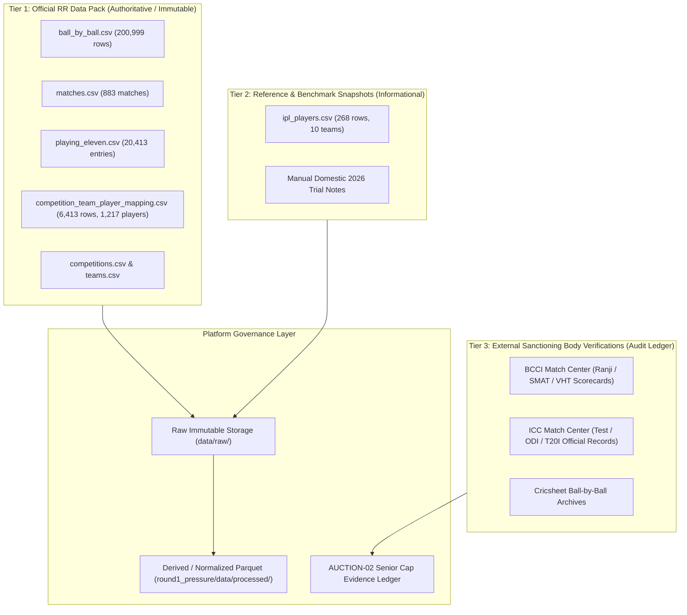

# ROYALS INTELLIGENCE — AUCTION-00 SOURCE PROVENANCE
## External Data Provenance, Source Hierarchy & Integrity Governance
**Domain:** RR Auction & Retention Intelligence (Stage AUCTION-00)  
**Execution Timestamp:** 2026-11-18T04:06:30+05:30  
**Audit Status:** COMPLETE & VERIFIED

---

## 1. Source Hierarchy & Data Lineage

The ROYALS INTELLIGENCE analytical platform utilizes a tiered source hierarchy to ensure that all strategic inferences, player profiles, and eligibility classifications are anchored in auditable evidence.

---

## 2. Temporal Coverage & Scope Limitations

1. **Official Competition Window:**
   - The primary data pack covers fixtures spanning domestic Indian cricket (Syed Mushtaq Ali Trophy, Vijay Hazare Trophy, Ranji Trophy) and Indian Premier League matches from 2022 through 2026.
   - Total recorded matches: **883** (867 with delivery-level data, 16 abandoned/no-play).
2. **Pre-2022 Historical Cap Blindspot:**
   - Because the supplied ball-by-ball records begin in 2022, senior international caps earned prior to 2022 (e.g., historical Test or ODI debuts) cannot be inferred from the data pack alone.
   - *Governance Directive:* In AUCTION-02, historical caps are verified against authoritative ICC/BCCI debut registries, rather than assuming unrecorded players are uncapped.

---

## 3. Physical Storage & Immutability Governance

### 3.1 Raw Data Directory (`data/raw/rajasthan_royals/round_1_data_pack/`)
- All files in this directory are strictly **read-only**.
- No transformation, in-place cleaning, renaming, or row deletion is permitted.
- Any attempt to mutate these files is flagged as an audit failure.

### 3.2 Derived Normalized Storage
- Normalized datasets, Bayesian shrinkage models, and evidence profiles are written to isolated directories:
  - `round1_pressure/data/processed/` (Protected Round 1 Parquet files).
  - `data/validation/` (Auction eligibility and normalization ledgers).
- Full separation between raw source assets and derived analytical artifacts is enforced.

---

## 4. Source Evaluation & Reliability Framework

Rather than applying arbitrary mathematical weighting to sources, ROYALS INTELLIGENCE evaluates sources across four orthogonal, non-numerical dimensions:

| Dimension | Definition | Governance Policy |
| :--- | :--- | :--- |
| **Authority** | The legal or institutional standing of the data provider (e.g., ICC, BCCI, RR). | Authoritative sources override secondary or tertiary aggregators. |
| **Reliability** | The consistency and precision of recorded telemetry and scoring. | Ball-by-ball delivery feeds are verified against official scorecards. |
| **Completeness** | The extent of coverage across all legal balls, extras, and players. | Gaps (such as 16 abandoned matches) are explicitly logged and isolated. |
| **Verification Status** | Independent confirmation by two or more corroborating records. | Senior international cap status requires confirmed debut match evidence. |
