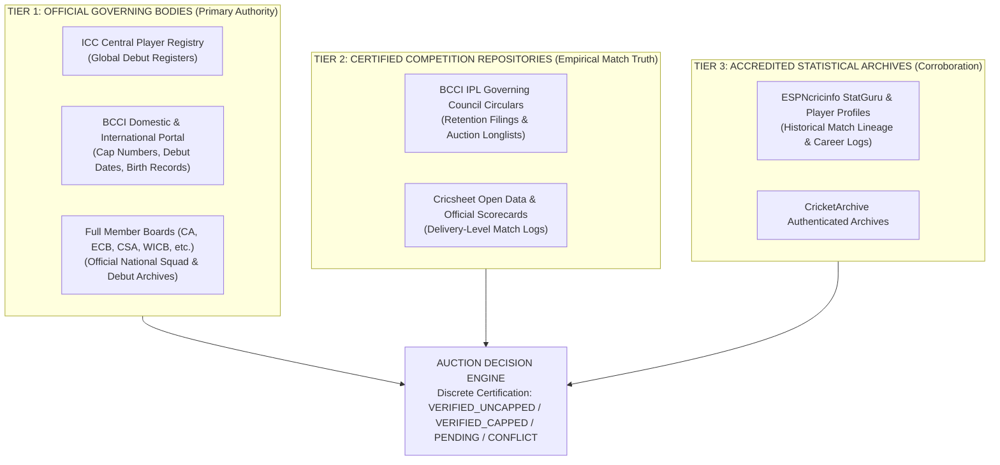

# ROYALS INTELLIGENCE — AUCTION-00 SOURCE REGISTRY
## Authoritative External Source Hierarchy, Provenance Ledger & Verification Protocols (Final Corrected Version)
**Domain:** RR Auction & Retention Intelligence (Stage AUCTION-00)  
**Execution Timestamp:** 2026-11-16T22:30:00+05:30  
**Target:** Ground Truth Certification for International Caps, Contracts, Availability & Statistics

---

## 1. Architectural Principles for External Sources

To guarantee integrity and eliminate arbitrary heuristics, ROYALS INTELLIGENCE strictly decouples four distinct evaluation concepts:
1. **Source Authority:** The legal or institutional standing of the data provider (e.g., official governing bodies vs accredited archives).
2. **Source Reliability:** The technical reproducibility, error rate, and auditability of the data feed.
3. **Evidence Completeness:** The breadth of historical coverage (e.g., career-long vs 2022–2026 window).
4. **Verification Status:** The individual verification outcome for a specific player (`VERIFIED_UNCAPPED`, `VERIFIED_CAPPED`, `PENDING_VERIFICATION`, `CONFLICTING_EVIDENCE`).

*Strict Governance Rule:* **Numerical source weights (e.g. 1.00, 0.95, 0.85) are strictly prohibited from determining player eligibility.** A player is never scored as "95% uncapped". Eligibility is an absolute, discrete certification founded upon authoritative primary records.



---

## 2. Senior International Cap Verification Protocols

### 2.1 The 2022–2026 Dataset Truncation Reality
Historical match coverage in the Round 1 data pack (spanning 2022–2026) is **strictly insufficient** to certify all-time senior international uncapped status. Players capped prior to 2022 (e.g., MS Dhoni, Ambati Rayudu, Robin Uthappa, Nathan Bracken, Jaydev Unadkat) have zero international appearances in the 2022–2026 window. Pure absence of international records in this data pack must never be used as uncapped proof.

### 2.2 Independent Verification Procedures by Format

#### A. Men's Test Cricket Verification
* **Governing Definition:** Any appearance in the starting XI of an official Men's Test match, or active participation as an approved concussion/COVID replacement who batted or bowled.
* **Verification Procedure:**
  1. Query ICC Test Cap Registry and national board Test cap records (e.g. BCCI Men's Test Cap register from #1 Amar Singh to present).
  2. Cross-reference debut scorecard and career summary in Tier 3 archives.
  3. If $\ge 1$ Test appearance is verified &rarr; Immediately certify as `VERIFIED_CAPPED`.

#### B. Men's One-Day International (ODI) Verification
* **Governing Definition:** Appearance in an official ICC Men's One-Day International.
* **Verification Procedure:**
  1. Query ICC and national board official ODI Cap Registries.
  2. Verify against full-career international match logs.
  3. If $\ge 1$ ODI appearance is verified &rarr; Immediately certify as `VERIFIED_CAPPED`.

#### C. Men's Twenty20 International (T20I) Verification
* **Governing Definition:** Appearance in an official Men's Twenty20 International between ICC Full Member or Associate Member nations with official T20I status.
* **Verification Procedure:**
  1. Query ICC Men's T20I match database and national board T20I registers.
  2. In the local data pack, 66 Indian players and 196 Overseas players are verified as capped via matches in `competition_team_player_mapping.csv`.
  3. For all candidates not mapped to an international team in 2022–2026, query global T20I archives dating back to the format's inception (2005).
  4. If $\ge 1$ T20I appearance is verified &rarr; Immediately certify as `VERIFIED_CAPPED`.

#### D. Non-Cap Boundaries (Strictly Uncapped Exclusions)
* **Under-19 International Cricket:** Representing a nation at the ICC U19 World Cup or bilateral U19 tours **does NOT constitute a senior international cap**. (e.g., Vaibhav Sooryavanshi and Lhuan-dre Pretorius remain strictly uncapped).
* **'A' Team Tours:** Matches for India A, England Lions, or Australia A against other 'A' teams or domestic sides are classified as First-Class or List A, **NOT senior international caps**.

---

## 3. Source Mapping by Analytical Domain

### 3.1 Domestic & Franchise Match Statistics
* **Objective:** Ingest verified delivery-level and scorecard data for Indian domestic and overseas franchise tournaments.
* **Authoritative Sources:**
  - *Internal Repository Data Pack:* `data/raw/rajasthan_royals/round_1_data_pack/` (**200,999 total deliveries, 192,709 legal deliveries across 883 matches (867 with delivery logs)**).
  - *BCCI Domestic Match Center:* `https://www.bcci.tv/domestic/` (Syed Mushtaq Ali Trophy ball-by-ball scorecards).
  - *Cricsheet Open Cricket Data:* `https://cricsheet.org/` (Standardized YAML/JSON match records for BBL, SA20, Hundred, CPL, PSL).

### 3.2 Current RR Squad & Contract Status
* **Objective:** Establish legally contracted squad members for IPL 2027 retention evaluation.
* **Authoritative Sources:**
  - *BCCI IPL Governing Council Retention Circulars:* Official press releases published ahead of the mega-auction deadline.
  - *IPL Official Website Squad Filings:* `https://www.iplt20.com/teams/rajasthan-royals/squad`
  - *Supplied Benchmark CSV:* `ipl_players.csv` (used strictly as an exploratory benchmark roster; **not authoritative contract proof**).

### 3.3 Auction Registration & Player Availability
* **Objective:** Verify whether a candidate is formally registered for the IPL 2027 Auction pool.
* **Authoritative Sources:**
  - *BCCI Official Auction Registered Player Longlist:* Published 3 weeks prior to auction (~1,000+ registered cricketers with reserve prices).
  - *BCCI Official Auction Shortlist:* Final list pruned by franchise submissions (~350–400 players).
* **Protocol:** Default state is `AUCTION_REGISTRATION: PENDING_OFFICIAL_LONGLIST`. No candidate is assumed available without registration proof.

### 3.4 National Board NOC & Overseas Availability
* **Objective:** Audit tournament availability for overseas candidates.
* **Authoritative Sources:**
  - *ICC Future Tours Programme (FTP) 2023–2027:* Official bilateral series schedule to identify calendar overlaps with the March–May IPL window.
  - *National Board NOC Policy Circulars:* Official releases from Cricket Australia, ECB, CSA, WICB, etc.

### 3.5 Age & Date of Birth Verification
* **Objective:** Verify candidate chronological age without fabrication.
* **Authoritative Sources:**
  - *BCCI Central Domestic Registration ID System:* Official birth certificate verification records for Indian domestic cricketers.
  - *ICC Official Player Profiles:* Official DOB registered for international tournaments.
  - *Supplied CSV Reference:* Integer age from `ipl_players.csv` flagged as `INTEGER_ROSTER_REFERENCE`.

---

## 4. Candidate Provenance Evidence Block Specification

Every candidate record ingested into the Auction & Retention domain must attach an immutable provenance JSON block recording discrete verification outcomes:

```json
{
  "player_id": 8101,
  "canonical_name": "Ashutosh Sharma",
  "verification_timestamp": "2026-11-16T22:30:00Z",
  "reviewer_process": "AUTOMATED_TIER1_CRAWLER_V1",
  "senior_international_caps": {
    "test_caps": 0,
    "odi_caps": 0,
    "t20i_caps": 0,
    "total_senior_caps": 0,
    "certification_status": "VERIFIED_UNCAPPED",
    "verification_source": "BCCI_CENTRAL_REGISTRY_AND_ICC_ARCHIVE",
    "source_url": "https://www.bcci.tv/players/ashutosh-sharma"
  },
  "demographics": {
    "integer_age": 26,
    "dob": null,
    "dob_status": "PENDING_BCCI_BIRTH_REGISTRY_CERTIFICATE",
    "provenance": "ipl_players.csv (Row 148)"
  },
  "contract_and_auction": {
    "supplied_csv_franchise": "Punjab Kings",
    "verified_current_squad": "UNCONFIRMED_PENDING_BCCI_CIRCULAR",
    "auction_registration": "PENDING_OFFICIAL_IPL_2027_LONGLIST",
    "noc_status": "NOT_APPLICABLE_INDIAN_DOMESTIC"
  }
}
```
