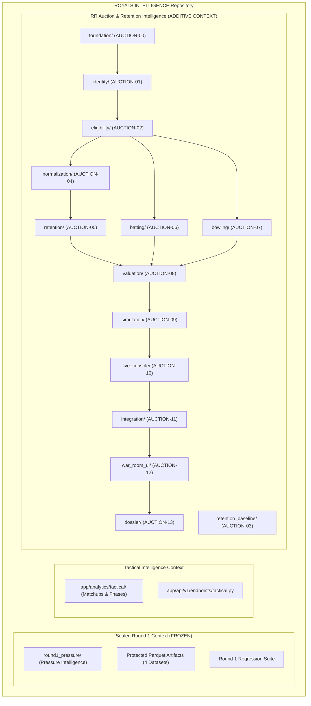

# ROYALS INTELLIGENCE — AUCTION-00 TARGET ARCHITECTURE
## Bounded Context Architecture, Component Boundaries & Future Stage Roadmap
**Domain:** RR Auction & Retention Intelligence (Stages AUCTION-00 to AUCTION-13)  
**Execution Timestamp:** 2026-11-18T07:27:30+05:30  
**Architectural Paradigm:** Additive Bounded Context (Domain-Driven Design)  
**Audit Status:** COMPLETE & VERIFIED

---

## 1. Architectural Mandate & Bounded Context

The **RR Auction & Retention Intelligence** platform is designed as an independent, additive bounded context within the ROYALS INTELLIGENCE ecosystem.

---

## 2. Core Architectural Principles

1. **Strict Context Decoupling:**
   - Auction services do NOT import or depend on Round 1 Pressure score algorithms.
   - Tactical matchup logic does NOT leak into auction candidate valuation.
   - Shared utilities (logging, base settings, hash checkers) may be utilized, but domain models remain completely isolated.
2. **Immutability of Sealed Round 1 Artifacts:**
   - The four protected Parquet artifacts (`batting_leaderboard.parquet`, `bowling_leaderboard.parquet`, `batting_evidence_profiles.parquet`, `bowling_evidence_profiles.parquet`) are read-only invariants.
3. **Traceability & Full Provenance:**
   - Every candidate profile, retention recommendation, and auction valuation carries a complete audit trail linking back to raw delivery rows and official ICC/BCCI debut scorecards.
4. **Deterministic Ranking & Sensitivity Testing:**
   - Candidate rankings are strictly deterministic. Weight sensitivity analyses and Bayesian shrinkage diagnostics must accompany all recommendation outputs.

---

## 3. Detailed Component Breakdown (AUCTION-00 through AUCTION-13)

### Phase 0: Foundations & Data Readiness (COMPLETED)
- **AUCTION-00 (Foundation & Data Readiness):** Data pack ingestion, delivery semantics (192,709 legal / 8,290 extras), match coverage (867 played / 16 abandoned), RR squad baseline (27 players: 12/6/5/4), and data quality auditing.

### Phase 1: Identity, Eligibility & Normalization (IMPLEMENTED)
- **AUCTION-01 (Canonical Player Registry):** Multi-competition entity unification (1,217 players), 23 alias mappings, duplicate disambiguation (`RR-PLAYER-XXXXX`).
- **AUCTION-02 (Senior Cap Verification):** 3-format cap verification ledger, bench call-up exclusion, discrete 4-state eligibility classification.
- **AUCTION-03 (Salary Cap & Retention Governance):** Financial modeling under BCCI IPL 2025–2027 retention brackets (₹18 Cr, ₹14 Cr, ₹11 Cr, ₹4 Cr uncapped).
- **AUCTION-04 (Cross-Competition Normalization):** Empirical Bayes shrinkage, competition quality adjustments (SMAT, VHT, IPL), sample size confidence tiers.

### Phase 2: Retention & Uncapped Target Engines
- **AUCTION-05 (Top 3 Retention Intelligence - IMPLEMENTED):** Evaluates 27-player RR baseline; produces exactly 3 retention recommendations with deterministic tie-breaking and explainability dossiers.
- **AUCTION-06 (Top 10 Uncapped Batting Intelligence):** Combines Indian and overseas uncapped batters into a unified Top 10 auction target board.
- **AUCTION-07 (Top 10 Uncapped Bowling Intelligence):** Combines Indian and overseas uncapped bowlers into a unified Top 10 auction target board.

### Phase 3: Valuation, Simulation & War-Room Operations (FUTURE)
- **AUCTION-08 (Valuation & Price Ceiling):** Maximum Willingness to Pay (WTP), surplus valuation, and inflation-adjusted budget curves.
- **AUCTION-09 (Bidding Simulation & Game Theory):** Opponent bidding behavior modeling, paddle strategies, RTM decision matrices.
- **AUCTION-10 (Live Auction Command Console):** Real-time purse tracking, slot-fill monitoring, accelerated auction scenario switching.
- **AUCTION-11 (Platform End-to-End Integration):** Backend API router aggregation, health endpoints, unified database persistence.
- **AUCTION-12 (Live Operational War-Room UI):** Next.js real-time war-room dashboard with live salary cap visualization and bid recommendation widgets.
- **AUCTION-13 (Final RR 2027 Auction Dossier):** Authoritative executive dossier compiling the 23-player strategic recommendation portfolio (3 Retentions + 10 Batters + 10 Bowlers).

---

## 4. API & Data Contract Specifications

All auction APIs conform to the FastAPI standard under prefix `/api/v1/auction`:
- `GET /api/v1/auction/foundation/ingestion-summary` $\rightarrow$ `FoundationDataIngestionReport`
- `GET /api/v1/auction/foundation/quality-report` $\rightarrow$ `List[DataQualityIssue]`
- `GET /api/v1/auction/identity/players` $\rightarrow$ `List[PlayerIdentityMapping]`
- `GET /api/v1/auction/eligibility/ledger` $\rightarrow$ `EligibilityLedgerSummary`
- `GET /api/v1/auction/retention/recommendations` $\rightarrow$ `Top3RetentionResponse`
- `GET /api/v1/auction/targets/batting` $\rightarrow$ `Top10UncappedBattersResponse`
- `GET /api/v1/auction/targets/bowling` $\rightarrow$ `Top10UncappedBowlersResponse`
