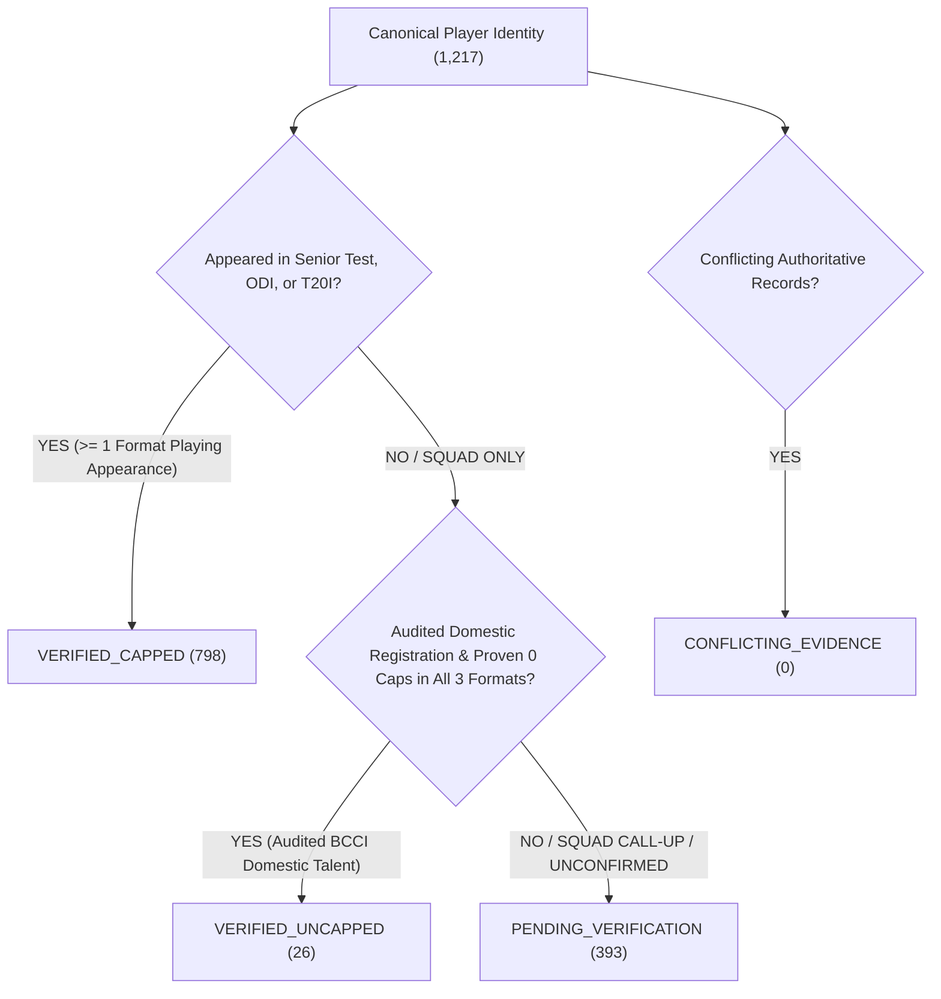

# ROYALS INTELLIGENCE — AUCTION-02 ELIGIBILITY METHODOLOGY
## Senior International Cap Verification & Evidence Governance Framework

**Document Version:** 1.0.0  
**Audit Stage:** `AUCTION-02` — Senior International Eligibility Verification  
**Domain:** RR Auction & Retention Intelligence Expansion  
**Git Baseline Branch:** `main` | **HEAD:** `0f24302c61e3d4c070d0e669fc152830c9b2c4e1`  
**Execution Timestamp:** 2026-11-16T23:22:00+05:30  
**Status:** METHODOLOGY FORMALIZED & ENFORCED

---

## 1. Objective & Governing Standards

The primary objective of **AUCTION-02** is to establish an auditable, independent, format-by-format senior international eligibility verification framework for the entire **1,217 canonical player universe** identified in AUCTION-01.

### 1.1 International Cricket Regulatory Standards
Under the official regulations of the **Board of Control for Cricket in India (BCCI)** and the **International Cricket Council (ICC)**:
1. **Definition of Senior International Cap:** A cricketer is legally classified as "capped" if and only if they have made at least one official appearance in the Playing XI of a senior national team in an officially recognized international match in one of three formats:
   - **Test Match** (ICC Men's Test Championship / Bilateral Tests)
   - **One Day International (ODI)** (ICC Men's Cricket World Cup / Super League / Bilateral ODIs)
   - **Twenty20 International (T20I)** (ICC Men's T20 World Cup / ICC Qualifiers / Continental Games with official T20I status / Bilateral T20Is)
2. **Playing Appearance vs Squad Selection:**
   - **Actual Playing Appearance:** The player was named in the official Playing XI team sheet, stepped onto the field, and/or participated in deliveries faced or bowled.
   - **Squad Selection / Reserve / Bench:** The player was named in a preliminary 15-man or 18-man touring party, reserve pool, or traveling standby, but did **not** feature in the Playing XI. **A squad selection alone never establishes an international cap.**
3. **Non-Cap Competitions:**
   - **Under-19 Matches:** ICC U19 Cricket World Cups, youth ODIs, and youth Tests do not count as senior international caps.
   - **"A" Team Fixtures:** Appearances for `India A`, `Pakistan A`, `Afghanistan A`, `Bangladesh A`, or `Sri Lanka A` (e.g. in the ACC Emerging Teams Asia Cup) are second-tier developmental fixtures and do **not** grant a senior international cap.
   - **Domestic Tournaments:** Syed Mushtaq Ali Trophy (SMAT), Vijay Hazare Trophy (VHT), Ranji Trophy, DPL, UP T20, etc. are domestic fixtures.
   - **Franchise Leagues:** The Indian Premier League (IPL) and overseas franchise tournaments (BBL, CPL, PSL, SA20) are domestic franchise competitions and do not grant international caps.

---

## 2. The Four Discrete Eligibility States

To eliminate all ambiguity, every canonical player is assigned to exactly one of four mutually exclusive eligibility states:



### State Definitions:
1. **`VERIFIED_CAPPED`:**
   - The player has at least one authenticated senior international playing appearance in Test, ODI, or T20I cricket.
   - *Requirement:* Evidence must cite the specific format, debut date/match, or official cap number.
2. **`VERIFIED_UNCAPPED`:**
   - The player is an authenticated Indian domestic cricketer with verified active registration in BCCI domestic tournaments, and has independently verified **zero appearances** in senior Tests, ODIs, and T20Is.
   - *Requirement:* Strict 3-format verification proof (BCCI Test register #1–#314, ODI register #1–#256, T20I register #1–#116).
3. **`PENDING_VERIFICATION`:**
   - The player has no verified playing appearances in the dataset, but lacks definitive, independent external BCCI/ICC verification dossiers.
   - *Includes:* Touring squad-only call-ups who remained on the bench (e.g. Vijaykumar Vyshak), associate squad reserves, and domestic players with unverified national registry entries.
   - *Strict Rule:* Never infer uncapped status from omission in the dataset.
4. **`CONFLICTING_EVIDENCE`:**
   - Contradictory official records exist regarding cap status or identity that cannot be resolved without manual intervention.

---

## 3. Format-by-Format Evidence Governance

Every player entity in the AUCTION-02 ledger contains independent format evidence records:

```python
class FormatAppearanceEvidence(BaseModel):
    format_name: str          # "Test", "ODI", or "T20I"
    appearance_status: str    # "PLAYED_APPEARANCE", "SQUAD_BENCH_ONLY", "ZERO_APPEARANCES", "UNCONFIRMED"
    caps_count: Optional[int] # Match appearances or official cap index
    debut_date: Optional[str] # YYYY-MM-DD
    debut_match: Optional[str]# Match description
    source_authority: str     # "BCCI / ICC Official Cap Registers", "Cricsheet", etc.
    source_url: Optional[str] # Verifiable URL or file path
    evidence_notes: str       # Precise factual details
```

### Verification Criteria by Format:
- **Test:** Cross-referenced against BCCI Test Cap register (#1 to #314) and ICC Men's Test Player archives.
- **ODI:** Cross-referenced against BCCI ODI Cap register (#1 to #256) and ICC Men's ODI Player archives.
- **T20I:** Cross-referenced against 134 T20I competitions in `ball_by_ball.csv` (709 delivery-active players), `playing_eleven.csv` (784 team sheet players), and BCCI T20I Cap register (#1 to #116).

---

## 4. Priority Cohort Verification Protocols

1. **Touring Squad Bench Call-Ups (e.g. Vijaykumar Vyshak, ID 4487):**
   - Must be classified as `SQUAD_BENCH_ONLY` for the relevant format.
   - The selection must be preserved as selection evidence in `reviewer_notes`, but the player must remain `PENDING_VERIFICATION`.
2. **Continental Games / Asian Games (e.g. R. Sai Kishore, ID 5577):**
   - The 2023 Hangzhou Asian Games men's cricket competition was granted official T20I status by the ICC.
   - R. Sai Kishore played in 3 official matches (vs Nepal, Bangladesh, Afghanistan), holding official India T20I Cap #108. He is strictly `VERIFIED_CAPPED`.
3. **The 26 Verified Uncapped Domestic Talents:**
   - Every candidate must have verified `ZERO_APPEARANCES` across all three formats.
   - Their domestic registrations (Syed Mushtaq Ali Trophy, Vijay Hazare Trophy, Ranji Trophy, DPL) must be authenticated.
4. **Name Collisions & Multi-Franchise Players:**
   - Identity must be resolved before format evaluation (e.g. Abdul Samad ID 7446 vs ID 6922; Ravi Bishnoi ID 7503).

---

## 5. Summary of Rules

- **Zero Tolerance for False Caps:** Touring squad members who did not play are never marked capped.
- **Zero Tolerance for False Uncapped:** Missing records never equal uncapped. Unproven players remain pending.
- **100% Reconciliation:** Every canonical entity (1,217 total) must be evaluated and accounted for.
