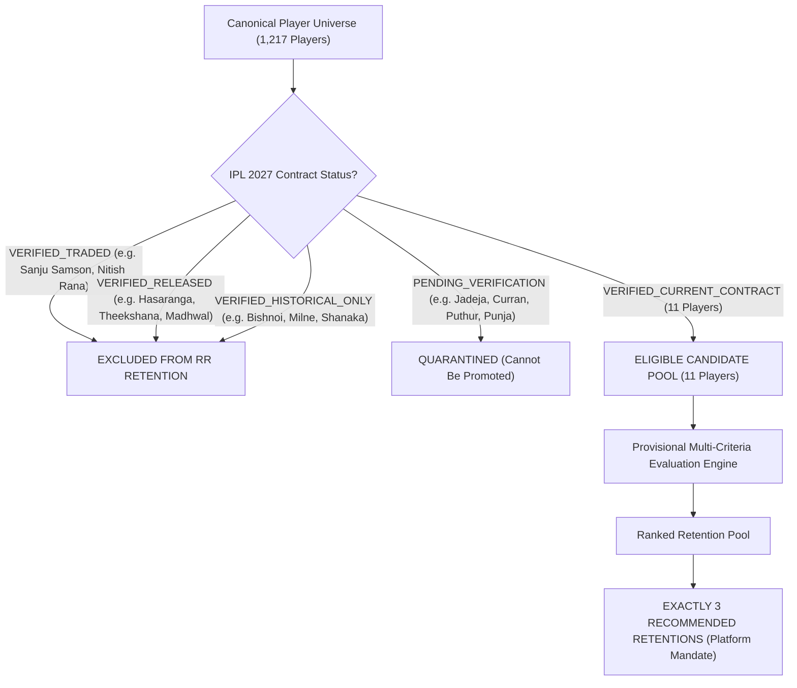

# ROYALS INTELLIGENCE — AUCTION-03 RETENTION GOVERNANCE
## Retention Candidate Universe Governance & Selection Framework

**Document Version:** 3.0.0 (Reconciled with 2026 Baseline & Official Trade Data)  
**Phase:** RR Auction & Retention Intelligence Expansion  
**Stage:** `AUCTION-03` — Final Current-Squad Reconciliation and Retention Candidate Audit  
**Git Baseline Branch:** `main` | **HEAD:** `0f24302c61e3d4c070d0e669fc152830c9b2c4e1`  
**Execution Timestamp:** 2026-11-17T00:07:00+05:30  
**Status:** RECONCILIATION COMPLETE — STRICT RETENTION BOUNDARIES ENFORCED

---

## 1. Governance Objectives & Separation of Concepts

The primary objective of the retention module is to recommend **exactly three players for retention** from the Rajasthan Royals contracted squad for the IPL 2027 season.

### 1.1 Separation of Regulatory Boundaries
1. **Platform Recommendation Requirement (Exactly 3 Players):**
   - This is an internal **Royals Intelligence decision-support mandate**.
   - It is designed to advise franchise leadership on optimal core retention.
2. **Official BCCI Mini-Auction Retention Limits:**
   - Under official BCCI mini-auction rules, there is **no statutory upper retention limit** of 3 players; teams may legally retain any number of contracted players within their salary purse.
3. **Franchise Decision Authority:**
   - The actual corporate decision to retain or release players remains strictly the prerogative of Rajasthan Royals management.

---

## 2. Retention Eligibility Funnel Architecture

Every player from the canonical universe must pass through a strict evidentiary filter separating historical squad participation (`ipl_2026_squad_status`) from verified 2027 contract status (`ipl_2027_contract_status`):

---

## 3. Eligible Candidate Universe Analysis

### 3.1 The 11 Verified Retention Candidates (`VERIFIED_CURRENT_CONTRACT`)
Only these 11 players possess verified, active contracts extending through the 2027 season without trade or release events:

| Canonical ID | Canonical Key | Player Name | Tactical Role | AUCTION-02 Cap Status | Contract Salary |
| :---: | :---: | :--- | :--- | :---: | :---: |
| **6819** | `RR-PLAYER-06819` | Yashasvi Jaiswal | Top-Order Batter | `VERIFIED_CAPPED` | ₹18.00 Crore |
| **6423** | `RR-PLAYER-06423` | Riyan Parag | Spin Bowling All-Rounder | `VERIFIED_CAPPED` | ₹14.00 Crore |
| **7260** | `RR-PLAYER-07260` | Dhruv Jurel | Middle-Order Keeper-Batter | `VERIFIED_CAPPED` | ₹14.00 Crore |
| **3297** | `RR-PLAYER-03297` | Shimron Hetmyer | Overseas Finisher (WI) | `VERIFIED_CAPPED` | ₹11.00 Crore |
| **2411** | `RR-PLAYER-02411` | Sandeep Sharma | Death Overs Bowler | `VERIFIED_CAPPED` *(Uncapped Rule)* | ₹4.00 Crore |
| **3298** | `RR-PLAYER-03298` | Jofra Archer | Express Fast Bowler (ENG) | `VERIFIED_CAPPED` | ₹12.50 Crore |
| **6806** | `RR-PLAYER-06806` | Tushar Deshpande | Right-Arm Fast-Medium | `VERIFIED_CAPPED` | ₹6.50 Crore |
| **26663** | `RR-PLAYER-26663` | Kwena Maphaka | Left-Arm Fast (SA) | `VERIFIED_CAPPED` | ₹1.50 Crore |
| **50284** | `RR-PLAYER-50284` | Vaibhav Sooryavanshi | Top-Order Youth Batter | `PENDING_VERIFICATION` | ₹1.10 Crore |
| **25139** | `RR-PLAYER-25139` | Shubham Dubey | Middle-Order Finisher | `PENDING_VERIFICATION` | ₹0.80 Crore |
| **8580** | `RR-PLAYER-08580` | Yudhvir Singh (Charak) | Pace Bowling All-Rounder | `VERIFIED_UNCAPPED` | ₹0.35 Crore |

### 3.2 Threshold Sufficiency & Governance Guarantees:
- **Mandate Check:** The candidate pool contains **11 verified players**, which exceeds the platform recommendation requirement of 3 ($11 \ge 3$).
- **Zero Promotion Rule:** No players from `PENDING_VERIFICATION` (such as Ravindra Jadeja, Sam Curran, Donovan Ferreira, Vignesh Puthur, Yash Raj Punja, or Brijesh Sharma) are promoted to fill candidate slots.
- **Role Quota Rule:** The final 3 recommendations may consist of any combination of batters, bowlers, all-rounders, or wicketkeepers.

### 3.3 Sanju Samson (ID: 2258) — Conclusively Excluded (`VERIFIED_TRADED`)
- Under the official IPL trade announcement of 15 November 2025, Sanju Samson was officially traded to Chennai Super Kings for IPL 2026.
- While his historical achievements and records with Rajasthan Royals are preserved in the platform registry, he is legally ineligible for the RR 2027 retention candidate pool.

---

## 4. Comprehensive Review of Proposed Retention Weights

The five provisional evaluation dimensions remain under strict methodological review:

$$\begin{array}{|l|c|l|l|}
\hline
\textbf{Evaluation Dimension} & \textbf{Prov. Weight} & \textbf{Inclusion Rationale} & \textbf{Data Availability Status} \\
\hline
\textbf{1. Pressure Performance Index (PPI)} & \mathbf{30\%} & \text{Execution in high-leverage IPL match situations.} & \textbf{VERIFIED AVAILABLE} \text{ (Round 1 Parquet)} \\
\textbf{2. Tactical Scarcity \& Role Value} & \mathbf{25\%} & \text{Difficulty of replacing skill set in open auction.} & \textbf{PARTIALLY AVAILABLE} \text{ (AUCTION-01/02)} \\
\textbf{3. Financial Surplus Value } (\Delta V) & \mathbf{20\%} & \text{Spread between market valuation and contract salary.} & \textbf{MODELLING ASSUMPTION} \text{ (Requires V\_est)} \\
\textbf{4. Age, Prime \& Longevity} & \mathbf{15\%} & \text{Multi-year performance projection (2025–2030).} & \textbf{VERIFIED AVAILABLE} \text{ (Registry DOB/Age)} \\
\textbf{5. Complementary Team Balance} & \mathbf{10\%} & \text{Synergy across the three retained core members.} & \textbf{HEURISTIC MODEL} \text{ (Requires Matrix)} \\
\hline
\end{array}$$

---

## 5. Official BCCI Mini-Auction Retention Circular Reconciliation (IPL 2027)

Following the conclusion of the IPL 2026 season and ahead of the IPL 2027 mini-auction on December 16, 2026, Rajasthan Royals officially announced their final roster decisions:

### 5.1 Official Retained Players (17)
1. **Riyan Parag** (Captain, All-rounder)
2. **Yashasvi Jaiswal** (Batter)
3. **Vaibhav Sooryavanshi** (Batter)
4. **Ravindra Jadeja** (All-rounder)
5. **Dhruv Jurel** (Wicket-Keeper)
6. **Jofra Archer** (Overseas - ENG, Bowler)
7. **Ravi Bishnoi** (Bowler)
8. **Sandeep Sharma** (Bowler)
9. **Nandre Burger** (Overseas - SA, Bowler)
10. **Donovan Ferreira** (Overseas - SA, Wicket-Keeper)
11. **Lhuan-dre Pretorius** (Overseas - SA, Wicket-Keeper)
12. **Dasun Shanaka** (Overseas - SL, All-rounder)
13. **Shubham Dubey** (Batter)
14. **Aman Rao Perala** (Batter)
15. **Sushant Mishra** (Bowler)
16. **Brijesh Sharma** (Bowler)
17. **Yash Raj Punja** (Bowler)

### 5.2 Traded-In Players (2)
18. **Mohammed Shami** (Traded in from Lucknow Super Giants for ₹8 crore, Bowler)
19. **Manimaran Siddharth** (Traded in from Lucknow Super Giants for ₹75 lakh, Bowler)

### 5.3 Traded-Out Player (1)
- **Sam Curran** (Traded to Lucknow Super Giants for ₹2.4 crore, All-rounder)

### 5.4 Released Players (9)
1. **Shimron Hetmyer** (Overseas - WI, Batter)
2. **Tushar Deshpande** (Bowler)
3. **Adam Milne** (Overseas - NZ, Bowler)
4. **Kwena Maphaka** (Overseas - SA, Bowler)
5. **Kuldeep Sen** (Bowler)
6. **Yudhvir Singh Charak** (All-rounder)
7. **Vignesh Puthur** (Bowler)
8. **Ravi Singh** (Wicket-Keeper)
9. **Emanjot Singh Chahal** (All-rounder)

### 5.5 Pre-Auction Financial & Roster Capacity
- **Current Active Squad Entering Auction:** 19 players (14 Indian, 5 Overseas)
- **Available Auction Slots:** 6 slots (maximum squad limit: 25)
- **Available Overseas Slots:** 3 slots (maximum overseas limit: 8)
- **Purse Impact:** Net trade outlay of ₹6.35 crore (₹8.00 Cr + ₹0.75 Cr acquired - ₹2.40 Cr traded out).

