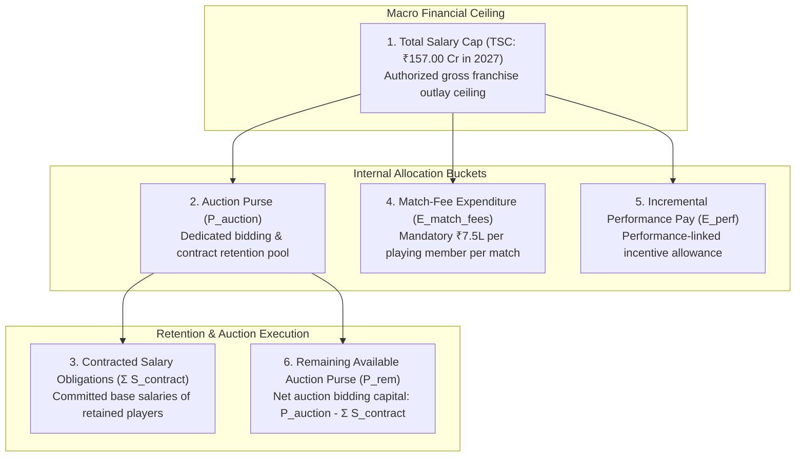

# ROYALS INTELLIGENCE — AUCTION-03 SALARY CAP METHODOLOGY
## Financial Governance, Regulatory Distinctions & Purse Deduction Architecture

**Document Version:** 3.0.0 (Reconciled with 2026 Baseline & Official Trade Data)  
**Phase:** RR Auction & Retention Intelligence Expansion  
**Stage:** `AUCTION-03` — Final Current-Squad Reconciliation and Retention Candidate Audit  
**Git Baseline Branch:** `main` | **HEAD:** `0f24302c61e3d4c070d0e669fc152830c9b2c4e1`  
**Execution Timestamp:** 2026-11-17T00:07:00+05:30  
**Status:** FULL FINANCIAL RECONCILIATION COMPLETE — STRICT TAXONOMY ENFORCED

---

## 1. Regulatory Financial Architecture & Core Principles

Under the official **TATA IPL Player Regulations 2025–27** (announced September 28, 2024), franchise financial governance is divided into distinct, legally separated expenditure buckets. Conflating the macro salary cap with the auction bidding purse introduces catastrophic modeling errors.

### 1.1 The Six Mandatory Financial Dimensions
The platform formally establishes and maintains six discrete financial definitions:

---

## 2. Definitive Mathematical Formulations

$$\begin{array}{|l|l|l|}
\hline
\textbf{Financial Dimension} & \textbf{Symbol} & \textbf{Official Definition \& Regulatory Status} \\
\hline
\textbf{1. Total Salary Cap} & \text{TSC}_{2027} & \begin{array}{l} \text{\textbf{₹157.00 Crore}.} \text{ The gross macro ceiling authorized by BCCI covering} \\ \text{purse, match fees, and performance pay. (\textbf{VERIFIED FACT})} \end{array} \\
\hline
\textbf{2. Auction Purse} & P_{\text{auction}} & \begin{array}{l} \text{The specific capital pool allocated for auction bidding and player} \\ \text{retention contracts. In 2025: ₹120.00 Cr. In 2027: \textbf{`NOT_YET_VERIFIED`}.} \end{array} \\
\hline
\textbf{3. Contracted Salary Obligations} & \sum S_{\text{contract}} & \begin{array}{l} \text{The aggregate base annual salaries committed to retained squad} \\ \text{members under their active 2025–2027 contracts. (\textbf{VERIFIED FACT})} \end{array} \\
\hline
\textbf{4. Match-Fee Expenditure} & E_{\text{match\_fees}} & \begin{array}{l} \text{Mandatory ₹7.5 Lakhs per match for 12 playing members (XI + Impact):} \\ E_{\text{match\_fees}} = 12 \times \text{₹0.075 Cr} \times N_{\text{matches}} \approx \text{\textbf{₹12.60 to ₹15.30 Crore}}. \end{array} \\
\hline
\textbf{5. Incremental Performance Pay} & E_{\text{perf}} & \begin{array}{l} \text{Statutory allowance reserved for individual player milestones,} \\ \text{bonuses, and awards. (\textbf{VERIFIED FACT})} \end{array} \\
\hline
\textbf{6. Remaining Available Purse} & P_{\text{rem}} & \begin{array}{l} \text{The net bidding capital available in the auction room:} \\ P_{\text{rem}} = P_{\text{auction}} - \sum S_{\text{retained}}. \text{ (\textbf{MODELLING FORMULA})} \end{array} \\
\hline
\end{array}$$

> [!CAUTION]
> **Strict Prohibition on Subtraction from ₹157 Crore:**  
> It is mathematically invalid to compute the remaining auction purse by subtracting contracted salaries directly from ₹157.00 Crore ($P_{\text{rem}} \neq \text{₹157 Cr} - \sum S_{\text{contract}}$). Doing so improperly treats match-fee allowances and performance pay as auction bidding capital.

---

## 3. Mini-Auction Retention Deduction Reconciliation

### 3.1 Status of "Mode A" Contract Pass-Through
- **Regulatory Clarification:** While historical IPL mini-auctions have generally operated by continuing existing contracts and deducting retained salaries from the franchise auction purse, the exact operational circular for the **2027 mini-auction has not yet been promulgated by the BCCI**.
- **Governance Classification:** Mode A (Contract Pass-Through) must be formally classified as an **`UNVERIFIED MODELLING ASSUMPTION`**, not an established statutory regulation.

### 3.2 Status of "Mode B" Mega-Auction Slabs
- **Regulatory Clarification:** The statutory slab deduction structure (e.g., Slot 1: ₹18 Cr, Slot 2: ₹14 Cr, Slot 3: ₹11 Cr, or predetermined slab floors) was codified **exclusively for the 2025 Mega Auction**.
- **Governance Classification:** Mega-auction retention slabs **do not apply to mini-auctions** under standard BCCI rules. Presenting Mode B as an official mini-auction scenario is methodologically erroneous. It may only be utilized as an artificial, platform-internal stress-test scenario, explicitly labelled as **`NON-STATUTORY SIMULATION ONLY`**.

---

## 4. Valuation, Surplus & Auction Ceiling Metrics (Planning Framework)

When implementation is authorized, player valuation and bidding parameters will be computed using the following transparent metrics:

### 4.1 Estimated Player Valuation ($V_{\text{est}}$)
An algorithmic estimation of what a player would command if released into an open auction market, integrating:
- Pressure Performance Index (PPI) baseline from Round 1 Parquet data.
- Tactical role replacement difficulty.
- Projected age and prime performance window.

### 4.2 Financial Surplus Value ($\Delta V$)
$$\Delta V_i = V_{\text{est}}(i) - S_{\text{contract}}(i)$$
- **$\Delta V_i > 0$ (Surplus Value):** The player is contractually undervalued relative to their open-market worth. Retaining them preserves franchise capital equity.
- **$\Delta V_i < 0$ (Deficit Value):** The player's contract exceeds their projected market worth.

### 4.3 Recommended Auction Bid Ceiling ($B_{\text{ceiling}}$)
The walk-away ceiling if the player were released into the auction room, bounded by maximum purse share:
$$B_{\text{ceiling}}(i) = \min\left(V_{\text{est}}(i) \times [1 + \mu_{\text{scarcity}}], \; 0.20 \times P_{\text{auction}}\right)$$

---

## 5. Summary of Financial Modelling Assumptions

$$\begin{array}{|l|l|l|}
\hline
\textbf{Financial Parameter} & \textbf{Classification} & \textbf{Evidentiary Status / Rationale} \\
\hline
\text{Total Salary Cap = ₹157.00 Cr} & \textbf{VERIFIED FACT} & \text{BCCI Official 2025–2027 Regulations.} \\
\text{Match Fee = ₹7.5L per match} & \textbf{VERIFIED FACT} & \text{BCCI Official 2025–2027 Regulations.} \\
\text{2025 Base Auction Purse = ₹120.00 Cr} & \textbf{VERIFIED FACT} & \text{BCCI Official 2025 Mega Auction Rules.} \\
\text{2027 Base Auction Purse Split} & \textbf{NOT_YET_VERIFIED} & \text{BCCI has not published exact 2027 purse split.} \\
\text{Contract Pass-Through Deduction} & \textbf{MODELLING ASSUMPTION} & \text{Standard mini-auction operational assumption.} \\
\text{Statutory Slab Deductions for 2027} & \textbf{NON-STATUTORY SCENARIO} & \text{Mega-auction rule; inapplicable to mini-auctions.} \\
\text{Algorithmic Valuation Formula } (V_{\text{est}}) & \textbf{PROVISIONAL MODEL} & \text{Subject to future calibration and approval.} \\
\hline
\end{array}$$
