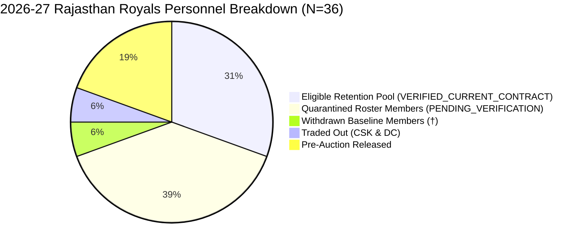

# ROYALS INTELLIGENCE — AUCTION-05 CANDIDATE EXPLAINABILITY DOSSIER
## Comprehensive Player-Level Analysis for All Rajasthan Royals Retention Candidates

**Document Version:** 1.0.0  
**Phase:** RR Auction & Retention Intelligence Expansion  
**Stage:** `AUCTION-05` — Retention Ranking Engine  
**Execution Timestamp:** 2026-11-17T01:43:00+05:30  
**Status:** COMPLETE & AUDITED

---

## 1. Candidate Universe Governance & Status Tiers

The 2026 Rajasthan Royals squad baseline consists of 25 active members, 2 withdrawn players, 2 traded-out players, and 7 pre-auction released players.

---

## 2. Granular Candidate Profiles (Eligible Pool $N=11$)

### Rank 1: Yashasvi Jaiswal (Canonical ID: 6819) — RECOMMENDED RETENTION #1
* **Canonical Key:** `RR-PLAYER-06819`
* **Role:** Batter (Left-Hand Opening Specialist) | **Verified Age:** 24.0 yrs | **Caps:** Senior International Capped
* **Contract Status:** `VERIFIED_CURRENT_CONTRACT` (Multi-year franchise core contract)
* **2026 Source Salary:** ₹18.00 Cr
* **Component Scores (Weighted Breakdown):**
  * Performance & Impact: **76.08** (Weight: 0.25 -> 19.02)
  * Squad Role Scarcity: **96.00** (Weight: 0.20 -> 19.20)
  * Replacement Difficulty: **98.00** (Weight: 0.20 -> 19.60) — *EXTREME*
  * Squad Balance Contribution: **93.00** (Weight: 0.15 -> 13.95)
  * Age & Career Stage: **100.00** (Weight: 0.05 -> 5.00) — *Peak Prime Age 24*
  * Consistency & Reliability: **95.00** (Weight: 0.05 -> 4.75) — *1,865 legal balls*
  * Sample Confidence: **100.00** (Weight: 0.10 -> 10.00) — *HIGH Confidence Tier*
* **Composite Retention Score:** **91.52 / 100.00**
* **Key Empirical Strengths:** Shrunk strike rate of $158.49$, boundary percentage of $25.68\%$, proven multi-season conversion in IPL powerplays.
* **Replacement Risk:** Complete loss of elite Indian left-handed opening anchor; open-market auction price would exceed ₹20 Cr with extreme bidding competition.
* **Why Ranked #1:** Unmatched combination of young age (24), elite production, and extreme auction replacement friction.

---

### Rank 2: Riyan Parag (Canonical ID: 6423) — RECOMMENDED RETENTION #2
* **Canonical Key:** `RR-PLAYER-06423`
* **Role:** All-rounder (Right-Hand Middle Order & Leg/Off Spin) | **Verified Age:** 25.0 yrs | **Caps:** Senior International Capped
* **Contract Status:** `VERIFIED_CURRENT_CONTRACT` (Multi-year franchise core contract)
* **2026 Source Salary:** ₹14.00 Cr
* **Component Scores (Weighted Breakdown):**
  * Performance & Impact: **73.63** (Weight: 0.25 -> 18.41)
  * Squad Role Scarcity: **94.00** (Weight: 0.20 -> 18.80)
  * Replacement Difficulty: **94.00** (Weight: 0.20 -> 18.80) — *VERY HIGH*
  * Squad Balance Contribution: **95.00** (Weight: 0.15 -> 14.25)
  * Age & Career Stage: **98.00** (Weight: 0.05 -> 4.90) — *Prime Age 25*
  * Consistency & Reliability: **95.00** (Weight: 0.05 -> 4.75) — *1,341 total legal balls*
  * Sample Confidence: **100.00** (Weight: 0.10 -> 10.00) — *HIGH Confidence Tier*
* **Composite Retention Score:** **89.91 / 100.00**
* **Key Empirical Strengths:** 1,081 balls faced at $152.61$ shrunk SR; 260 legal balls bowled conceding only $8.91$ RPO (below tournament par of $9.13$).
* **Replacement Risk:** Young Indian domestic all-rounders with proven middle-order boundary hitting are exceptionally scarce; reacquisition cost estimated at ₹14–17 Cr.
* **Why Ranked #2:** Dual-skill capability, prime age (25), and critical domestic middle-order stability.

---

### Rank 3: Dhruv Jurel (Canonical ID: 7260) — RECOMMENDED RETENTION #3
* **Canonical Key:** `RR-PLAYER-07260`
* **Role:** Wicketkeeper-Batter (Middle Order / Finisher) | **Verified Age:** 25.0 yrs | **Caps:** Senior International Capped
* **Contract Status:** `VERIFIED_CURRENT_CONTRACT` (Multi-year franchise core contract)
* **2026 Source Salary:** ₹14.00 Cr
* **Component Scores (Weighted Breakdown):**
  * Performance & Impact: **60.81** (Weight: 0.25 -> 15.20)
  * Squad Role Scarcity: **95.00** (Weight: 0.20 -> 19.00)
  * Replacement Difficulty: **92.00** (Weight: 0.20 -> 18.40) — *VERY HIGH*
  * Squad Balance Contribution: **96.00** (Weight: 0.15 -> 14.40)
  * Age & Career Stage: **98.00** (Weight: 0.05 -> 4.90) — *Prime Age 25*
  * Consistency & Reliability: **88.00** (Weight: 0.05 -> 4.40) — *798 legal balls*
  * Sample Confidence: **100.00** (Weight: 0.10 -> 10.00) — *HIGH Confidence Tier*
* **Composite Retention Score:** **86.30 / 100.00**
* **Key Empirical Strengths:** High strike-rate death-overs finisher ($151.11$ shrunk SR across 798 balls); solves the specialized wicketkeeping requirement.
* **Replacement Risk:** With Sanju Samson traded out, losing Jurel would leave Rajasthan Royals with zero experienced Indian wicketkeepers, forcing desperate auction bidding.
* **Why Ranked #3:** Solves the wicketkeeper role natively while preserving overseas slots for high-impact international auction acquisitions.

---

### Rank 4: Vaibhav Sooryavanshi (Canonical ID: 50284) — High-Ceiling Youth Asset
* **Role:** Batter | **Verified Age:** 15.0 yrs | **Composite Score:** **82.25**
* **Analysis:** Extraordinary raw numbers in emerging/U19 cricket (674 balls, $226.49$ shrunk SR, $38.1\%$ boundary rate). However, he has zero senior IPL appearances, and at age 15 represents an early-stage developmental incubation asset rather than an immediate top-3 retention pillar. His replacement friction at the auction is LOW, making him an ideal RTM or auction repurchase target rather than consuming a primary retention slot.

---

### Rank 5: Shimron Hetmyer (Canonical ID: 3297) — Overseas Power-Hitter
* **Role:** Batter (Overseas Finisher) | **Verified Age:** 29.0 yrs | **Composite Score:** **77.28**
* **Analysis:** Proven match-winner (1,244 balls, $157.70$ shrunk SR). However, retaining Hetmyer consumes 1 of only 8 available overseas squad slots and locks in substantial retention purse deductions for an overseas role where comparable power-hitting alternatives exist in the open global auction pool.

---

### Rank 6: Jofra Archer (Canonical ID: 3298) — Elite Overseas Pacer
* **Role:** Bowler (Overseas Fast Bowler) | **Verified Age:** 31.0 yrs | **Composite Score:** **75.60**
* **Analysis:** High bowling skill (1,261 balls, $9.24$ shrunk economy, $42.7\%$ dot balls). Ranked below the domestic core due to overseas slot consumption, age (31), and documented historical injury/workload volatility.

---

### Rank 7: Sandeep Sharma (Canonical ID: 2411) — Tactical Death Specialist
* **Role:** Bowler (Special Uncapped Status) | **Verified Age:** 33.0 yrs | **Composite Score:** **70.03**
* **Analysis:** Master of tactical wide-line yorkers and death overs ($9.06$ shrunk economy). Despite high skill, his age (33) and domestic bowling pool depth mean his open-market replacement friction is manageable (can be reacquired at ₹4–6 Cr).

---

### Rank 8 to 11: Depth & Developmental Candidates
* **Tushar Deshpande (ID: 6806):** Composite $67.14$ | Age 31 | Fast bowler with high economy volatility ($9.92$ shrunk economy).
* **Shubham Dubey (ID: 25139):** Composite $64.62$ | Age 32 | Domestic middle-order batter with limited sample size (142 balls).
* **Yudhvir Singh (ID: 8580):** Composite $62.58$ | Age 29 | Domestic pace all-rounder; moderate sample (138 balls bowled).
* **Kwena Maphaka (ID: 26663):** Composite $58.65$ | Age 20 | Young overseas fast bowler; high development ceiling but expensive economy ($10.97$ shrunk economy).

---

## 3. Quarantined Active Roster Members ($N=14$)

The following 14 active squad members are strictly quarantined under `PENDING_VERIFICATION` pending BCCI retention guidelines:

| Canonical ID | Canonical Name | Squad Role | 2026 Salary | Quarantined Governance Rationale |
| :---: | :--- | :--- | :---: | :--- |
| **152** | Ravindra Jadeja | All-Rounder | ₹18.00 Cr | Traded into RR; 2027 extension pending official confirmation. |
| **7503** | Ravi Bishnoi | Bowler (Spin) | ₹11.00 Cr | Multi-franchise roster entry; multi-year extension pending audit. |
| **8182** | Donovan Ferreira | All-Rounder (OS) | ₹0.75 Cr | Traded into RR; 2027 extension pending circular. |
| **7312** | Nandre Burger | Bowler (OS) | ₹0.50 Cr | 2026 squad member; 2027 status pending verification. |
| **7545** | Kuldeep Sen | Bowler | ₹0.75 Cr | 2026 auction buy; 2027 extension unconfirmed. |
| **1487** | Adam Milne | Bowler (OS) | ₹0.50 Cr | 2026 squad entry; 2027 status pending. |
| **2436** | Dasun Shanaka | All-Rounder (OS) | ₹0.50 Cr | 2026 squad entry; 2027 status pending. |
| **43798** | Lhuan Pretorius | Wkt-Batter (OS) | ₹0.50 Cr | 2026 auction buy; developmental overseas keeper. |
| **48557** | Vignesh Puthur | Bowler | ₹0.30 Cr | 2026 auction buy; unverified extension. |
| **41503** | Yash Raj Punja | Bowler | ₹0.30 Cr | 2026 auction buy; unverified extension. |
| **67036** | Brijesh Sharma | Bowler | ₹0.30 Cr | 2026 auction buy; unverified extension. |
| **7269** | Sushant Mishra | Bowler | ₹0.30 Cr | 2026 squad member; unverified extension. |
| **43965** | Emanjot Chahal | All-Rounder | ₹0.30 Cr | 2026 auction buy; unverified extension. |
| **47523** | Aman Rao | Batter | ₹0.30 Cr | 2026 auction buy; unverified extension. |

---

## 4. Traded and Withdrawn Personnel ($N=4$)

* **Sanju Samson (ID: 2258):** Classified as `VERIFIED_TRADED`. Officially traded to Chennai Super Kings on 15 November 2025 at ₹18.00 Cr league fee. Legally barred from Rajasthan Royals retention pool.
* **Nitish Rana (ID: 4246):** Classified as `VERIFIED_TRADED`. Officially traded to Delhi Capitals on 15 November 2025 at ₹4.20 Cr league fee. Legally barred from RR retention pool.
* **Sam Curran (ID: 4409):** Classified as `WITHDRAWN`. Marked with `†` in official roster records; excluded from active squad baseline.
* **Ravi Singh (ID: 60700):** Classified as `WITHDRAWN`. Marked with `†` in official roster records; excluded from active squad baseline.
