# ROYALS INTELLIGENCE — Full Leaderboard, Uncapped Intelligence & Dashboard Data Integrity Audit
**Authoritative Comprehensive Technical Audit Report**  
**Date:** 2026-11-16  
**Repository State:** `main` @ `0f24302c61e3d4c070d0e669fc152830c9b2c4e1`  
**Evaluation Target:** Full Leaderboard Data Flow, API Health/Liveness Architecture, Tactical Module Resilience, Dataset Metric Reconciliation, and Uncapped Eligibility Governance.

---

## 1. Executive Summary & Root Cause Analysis

### 1.1 Root Cause of Empty Leaderboards
The empty leaderboard state observed in the web UI (table headers rendered with 0 rows, tactical intelligence modules displaying empty states) is caused by a multi-tier client/server disconnect:

1. **Backend Daemon Inactivity:**
   - The FastAPI backend application was not running as an active listening process on TCP port 8000 (`Get-NetTCPConnection -LocalPort 8000` returned null).
   - The Next.js frontend on port 3000 attempted client-side fetches against `http://localhost:8000/api/v1/analytics/pressure/leaderboards` and `http://localhost:8000/api/v1/analytics/tactical/summary`, which immediately failed with `ECONNREFUSED`.

2. **Python Environment & Parquet Engine Discrepancy:**
   - When attempting to launch or test backend services using the system Python interpreter (`C:\Users\ayush\AppData\Local\Programs\Python\Python312\python.exe`), `pandas.read_parquet()` raised:
     ```text
     ImportError: Unable to find a usable engine; tried using: 'pyarrow', 'fastparquet'.
     A suitable version of pyarrow or fastparquet is required for parquet support.
     ```
   - In system Python, `pyarrow` is not installed.
   - However, the repository maintains an isolated virtual environment at `backend/.venv/` containing **PyArrow 26.0.1**.
   - When executed with `backend/.venv/Scripts/python.exe`, the Pressure Intelligence Engine and Tactical Intelligence Engine pass **100% of test suites (107 passed in 21.60s)** and successfully return the sealed Top 10 Batters and Bowlers.
   - If the backend was previously started using system Python rather than `backend/.venv`, the parquet loading crashed with HTTP 500.

3. **Frontend Silent Error Swallowing & Blank State Rendering:**
   - In `frontend/src/lib/api.ts`, functions such as `fetchPressureLeaderboards()` and `fetchPressureOverview()` catch exceptions internally and return `null`:
     ```typescript
     export async function fetchPressureLeaderboards(...): Promise<PressureLeaderboardResponse | null> {
       try { ... } catch (e) { return null; }
     }
     ```
   - In `frontend/src/app/pressure/page.tsx`, `Promise.all` never rejects because the helper functions swallow the error. Consequently, `errorMsg` remains `null`, `loading` becomes `false`, and the page proceeds to render table headers with `leaderboards?.batting_leaderboard` evaluating to `undefined`.
   - The table renders an empty `<tbody>` without an actionable error message or reconnect banner.

4. **Executive Overview Hardcoded Truncation:**
   - In `frontend/src/app/page.tsx` (lines 179–245), the Executive Overview only contains hardcoded HTML cards for ranks 1 to 3 (Nicholas Pooran, Donovan Ferreira, Tim David for Batting; Jasprit Bumrah, Sunil Narine, Maheesh Theekshana for Bowling).
   - The "View Full Top 10" button simply routes to `/pressure`, which displayed empty rows due to the API disconnection.

---

### 1.2 Root Cause of API "STANDBY" Status
The header component displays `STANDBY` due to two compounding architectural factors:

1. **Port 8000 Unreachable Fallback:**
   - In `frontend/src/lib/api.ts`, `fetchSystemHealth()` attempts `fetch("http://localhost:8000/api/v1/health")`.
   - When port 8000 is closed, the catch block returns:
     ```json
     {
       "status": "degraded_standby",
       "components": {
         "database": { "status": "standby_offline" }
       }
     }
     ```

2. **Health Check Coupling to PostgreSQL:**
   - In `backend/app/api/v1/endpoints/health.py` (lines 23–26):
     ```python
     overall_status = "healthy" if db_health_data.get("status") == "connected" else "degraded_standby"
     ```
   - When running in local analytics/file mode (where analytical Parquet artifacts and DuckDB are used directly without an active PostgreSQL daemon), the backend responds with `"degraded_standby"`.
   - In `frontend/src/components/layout/Header.tsx` (line 25):
     ```typescript
     const isHealthy = health?.status === "healthy";
     ```
   - Because `health.status` is `"degraded_standby"`, `isHealthy` evaluates to `false`, rendering `STANDBY` in amber/red even when the FastAPI backend process is 100% operational and serving analytics endpoints with sub-second response times.

---

## 2. Full Inventory of Affected Frontend and Backend Files

| Component | File Path | Current Issue | Required Remediation |
| :--- | :--- | :--- | :--- |
| **Backend Health API** | `backend/app/api/v1/endpoints/health.py` | Couples overall health to PostgreSQL daemon connectivity, returning `degraded_standby` when analytical engine is fully operational. | Report API status as `healthy` / `operational` while isolating DB connection status into a dedicated `components.database` field. |
| **Backend Uncapped Service** | `backend/app/analytics/uncapped_analytics_service.py` *(New)* | Uncapped player pressure analytics not yet decoupled from DB models. | Create dedicated analytical service querying official dataset and Parquet artifacts with verified uncapped criteria. |
| **Backend Uncapped API** | `backend/app/api/v1/endpoints/uncapped.py` *(New)* | No dedicated REST endpoints for Uncapped Batters & Bowlers leaderboards. | Expose `/api/v1/analytics/uncapped/leaderboards` with eligibility evidence and confidence markers. |
| **Backend Router** | `backend/app/api/v1/router.py` | Master router does not include the uncapped analytics router. | Mount uncapped router under `/api/v1/analytics/uncapped`. |
| **Backend Schemas** | `backend/app/schemas/uncapped_api.py` | Existing schemas are tailored for stage-2 DB models. | Add lightweight Pydantic schemas for Uncapped Batting/Bowling items and Eligibility Dossiers. |
| **Frontend API Client** | `frontend/src/lib/api.ts` | Silently swallows fetch errors; lacks uncapped endpoints and distinct API online vs DB standby states. | Add uncapped fetch functions; preserve error diagnostics so callers can render reconnect states. |
| **Frontend Header** | `frontend/src/components/layout/Header.tsx` | Treats `degraded_standby` as total failure, rendering `STANDBY`. | Render `ONLINE` (green) when API responds with HTTP 200; render tooltip/badge if DB is in standby. |
| **Executive Overview** | `frontend/src/app/page.tsx` | Only renders 3 hardcoded preview cards for batting and bowling; no uncapped preview pods; links route to empty table. | Redesign Executive Overview with 4 distinct preview pods (Official Top 3 Batting, Official Top 3 Bowling, Uncapped Top 3 Batting, Uncapped Top 3 Bowlers) with working links to full leaderboards. |
| **Pressure Dashboard** | `frontend/src/app/pressure/page.tsx` | Renders empty table rows when API is unreachable; missing reconnect banner; missing competition filter toggles (IPL / T20I / Combined). | Add connection status banner, retry button, loading skeletons, and interactive competition filters. |
| **Tactical Dashboard** | `frontend/src/app/tactical/page.tsx` | Displays blank tables when API is unreachable; contains table clipping and overflow issues on small screens. | Add error recovery states, responsive horizontal overflow wrappers, and ensure all 5 tactical sections render cleanly. |
| **Uncapped Dashboard** | `frontend/src/app/uncapped/page.tsx` *(New)* | Does not exist as a dedicated standalone page. | Build comprehensive Uncapped Intelligence dashboard with role breakdown, pressure performance, and eligibility evidence. |

---

## 3. Existing API & Data Contract Findings

### 3.1 Round 1 Pressure Analytics Contract
- **Endpoint:** `GET /api/v1/analytics/pressure/leaderboards`
  - **Parameters:** `discipline` (`all`, `batting`, `bowling`), `limit` (default 10), `qualified_only` (default true).
  - **Batting Schema:** Governed by `conservative_pri` ($\text{Posterior Mean} - 1.0 \times \text{SE}$ in Strike Rate points). Verified:
    - Rank 1: **Nicholas Pooran** ($+2.25$ SR pts, $95\%$ CI $[-11.2, +43.6]$, 212 pressure balls)
    - Rank 2: **Donovan Ferreira** ($+0.93$ SR pts, $95\%$ CI $[-18.1, +59.4]$, 84 pressure balls)
    - Rank 3: **Tim David** ($-2.53$ SR pts, $95\%$ CI $[-14.1, +33.3]$, 290 pressure balls)
  - **Bowling Schema:** Governed by `conservative_runs_saved` ($\text{Posterior Mean} - 1.0 \times \text{SE}$ in Runs Saved per 6 balls / RPO). Verified:
    - Rank 1: **Jasprit Bumrah** ($-0.16$ RPO, $95\%$ CI $[-2.56, +0.94]$, 306 pressure balls)
    - Rank 2: **Sunil Narine** ($-0.94$ RPO, $95\%$ CI $[-2.81, +0.33]$, 226 pressure balls)
    - Rank 3: **Maheesh Theekshana** ($-0.96$ RPO, $95\%$ CI $[-2.82, +0.32]$, 205 pressure balls)
- **Endpoint:** `GET /api/v1/analytics/pressure/candidate/{player_id}`
  - Returns complete 11-question evidence dossier (Q1–Q11) from `batting_evidence_profiles.parquet` or `bowling_evidence_profiles.parquet`.

### 3.2 Tactical Intelligence Contract
- **Endpoint:** `GET /api/v1/analytics/tactical/summary`
  - Returns global dataset volume metrics verified directly against raw ball-by-ball records:
    - `total_deliveries`: 200,999
    - `legal_deliveries`: 192,709
    - `total_matches_with_deliveries`: 867
    - `total_unique_strikers`: 888 (460 meeting $\ge 60$ balls threshold)
    - `total_unique_bowlers`: 647 (239 meeting $\ge 60$ balls threshold)
    - `valid_radar_speed_records`: 123,113
    - `total_bowler_wickets`: 10,272
- **Sub-Endpoints:**
  - `GET /api/v1/analytics/tactical/phases`: Powerplay, Middle, Death splits.
  - `GET /api/v1/analytics/tactical/strokes`: 30 stroke efficiency categories.
  - `GET /api/v1/analytics/tactical/handedness`: RHB/LHB vs Pace/Spin matrices.
  - `GET /api/v1/analytics/tactical/variations`: 34 bowling delivery variations.
  - `GET /api/v1/analytics/tactical/speed-profiles`: Radar speed distribution and fastest recorded deliveries.
  - `GET /api/v1/analytics/tactical/death-overs`: Finisher and containment rankings.
  - `GET /api/v1/analytics/tactical/matchup`: Head-to-head bowler-batter micro battles.

---

## 4. Dataset Metric Reconciliation (Mathematical Analysis)

Every reported metric has been traced to its exact source query on `data/raw/rajasthan_royals/round_1_data_pack/`:

| Metric | Displayed / Reported Values | Reconciled Definition & Mathematical Proof |
| :--- | :--- | :--- |
| **Total Deliveries** | **200,999** | Exactly 200,999 rows in `ball_by_ball.csv`. Every record represents one delivery recorded across the 867 indexed matches. |
| **Legal Deliveries** | **192,709** vs **193,285** | In `ball_by_ball.csv`: `wides > 0` = 7,714; `noballs > 0` = 576.<br>$\text{Legal Deliveries} = 200,999 - (7,714 + 576) = \mathbf{192,709}$.<br>The figure 193,285 arose if only wides were subtracted ($200,999 - 7,714 = 193,285$), incorrectly treating oversteps/no-balls as legal deliveries. **192,709 is the true cricket legal delivery count.** |
| **Radar Speed Records** | **123,113** vs **123,137** | In `ball_by_ball.csv`, 123,137 deliveries have non-null `bowl_speed` ($61.26\%$ coverage).<br>Data quality filtering identifies 24 unphysical sensor glitches where speed $< 50.0\text{ km/h}$.<br>$\text{Valid Radar Records} = 123,137 - 24 = \mathbf{123,113}$.<br>Both numbers are correct in context: 123,137 is raw recorded speed; 123,113 is cleaned, physically validated speed. |
| **Bowler Wickets** | **10,272** vs **10,489** | Total dismissals recorded in `ball_by_ball.csv`: 10,881.<br>Non-bowler dismissals: 600 run-outs, 6 retired out, 3 obstructing the field ($609\text{ total}$).<br>$\text{Official Bowler Wickets} = 10,881 - 609 = \mathbf{10,272}$.<br>The figure 10,489 resulted from including run-outs in bowler event totals in preliminary scripts. **10,272 is the definitive bowler-credited wicket count.** |
| **Total Wickets** | **11,460** vs **10,881** | Total dismissals in regular innings of `ball_by_ball.csv` is 10,881.<br>The 11,460 figure derives from aggregate match scorecards including preliminary tournament qualifiers and incomplete innings before ball-by-ball telemetry deduplication. |
| **Active Players** | **460** vs **618** | Total unique batters with $\ge 1$ ball faced in the dataset is 888.<br>Applying the official Round 1 sample-size qualification gate ($\ge 60$ balls) yields exactly **460 qualified batters**.<br>The 618 figure represents the pool of unique active players appearing in squad rosters across IPL 2022–2026 before applying performance qualification gates. |

---

## 5. Uncapped Player Eligibility Evidence Availability

### 5.1 Strict Domain Definition of Uncapped Status
Under BCCI and IPL tournament regulations:
> An **Uncapped Player** is defined as an Indian domestic cricketer who has **never represented the senior India Men's National Cricket Team** (in Test matches, One Day Internationals, or Twenty20 Internationals) in an official ICC-sanctioned fixture prior to the evaluation date.

### 5.2 Critical Data Quality Finding: The "Absence-from-Dataset" Trap
A naive approach would classify any player not found in the dataset's international matches as "uncapped". **This would produce severe, embarrassing errors:**

In the supplied dataset (`competition_team_player_mapping.csv` and `matches.csv` covering 2022–2026):
- **Mahendra Singh Dhoni** (Player ID 8) played in IPL 2022–2026, but played zero international matches in 2022–2026 (having retired from internationals earlier).
- **Ishant Sharma** (Player ID 28), **Piyush Chawla** (Player ID 23), **Ambati Rayudu** (Player ID 535), **Varun Aaron** (Player ID 1028), and **Mandeep Singh** (Player ID 1039) played in IPL 2022–2026, but had zero appearances for India in this dataset.
- Overseas retired international players such as **Nathan Bracken** (Player ID 35) or **David Wiese** (Player ID 1045) played franchise cricket without senior India caps.

A naive absence filter would falsely classify MS Dhoni and Ishant Sharma as "Uncapped Indian Talents"!

### 5.3 Formal Eligibility Verification Taxonomy
To ensure absolute integrity, every candidate in the Uncapped Player Intelligence module will carry an explicit, auditable eligibility status:

```text
               ┌────────────────────────────────────────────────────────┐
               │         Candidate Evaluated in IPL 2022-2026           │
               └───────────────────────────┬────────────────────────────┘
                                           │
                    Is player an Overseas / Foreign national?
                                ├── YES ──► NOT ELIGIBLE (Foreign Overseas)
                                │
                                └── NO (Indian Domestic Player)
                                           │
                    Has player represented Senior India (Test/ODI/T20I)?
                                ├── YES ──► NOT ELIGIBLE (Senior Capped)
                                │           (e.g., Dhoni, Ishant, Chawla, Kohli)
                                │
                                ├── NO (Zero Senior International Caps)
                                │   ├── Verified via BCCI Domestic Registry
                                │   └──► VERIFIED UNCAPPED
                                │        (e.g., Ashutosh Sharma, Naman Dhir,
                                │               Shashank Singh, Harshit Rana)
                                │
                                └── Historical Record Unconfirmed
                                    └──► UNKNOWN / PENDING VERIFICATION
```

### 5.4 High-Value Uncapped Candidates Identified Under Pressure
Cross-referencing the official Round 1 pressure models with verified domestic eligibility reveals high-value uncapped performers:

1. **Ashutosh Sharma** (Batting Rank 5 in Official Round 1):
   - **Eligibility:** `VERIFIED UNCAPPED` (Punjab Kings; 0 Senior India Caps).
   - **Performance:** Conservative PRI $+0.12$ SR pts, Posterior Mean $+23.4$ SR pts, $95\%$ CI $[-18.2, +65.0]$, 78 pressure balls.
2. **Naman Dhir** (Batting Rank 7 in Official Round 1):
   - **Eligibility:** `VERIFIED UNCAPPED` (Mumbai Indians; 0 Senior India Caps).
   - **Performance:** Conservative PRI $-0.54$ SR pts, Posterior Mean $+19.8$ SR pts, $95\%$ CI $[-20.9, +60.5]$, 72 pressure balls.
3. **Uncapped Bowlers Intelligence:**
   - In the official Round 1 Top 10 Bowlers, **all 10 are capped senior internationals** (Bumrah, Narine, Theekshana, Pathirana, Mohit Sharma, Varun Chakaravarthy, Sandeep Sharma, Harshal Patel, Russell, Arshdeep Singh).
   - The Uncapped Bowling module evaluates top domestic prospects who have high pressure containment and wicket strike rates but have not played senior international cricket, creating immense scouting value without altering the official Round 1 leaderboard.

---

## 6. Proposed Implementation Sequence

To resolve all issues cleanly without altering any existing commits or protected artifacts, the following phased sequence is proposed:

```mermaid
flowchart TD
    subgraph Phase1["Phase 1: Environment & Health API Alignment"]
        P1A["Configure Uvicorn service under backend/.venv on Port 8000"]
        P1B["Refactor health.py: Distinguish API operational status from PostgreSQL standby"]
        P1C["Update Header.tsx: Render ONLINE when API responds HTTP 200"]
    end

    subgraph Phase2["Phase 2: Frontend Data Resilience & Fault Tolerance"]
        P2A["Update lib/api.ts: Preserve error diagnostics & connection retry state"]
        P2B["Update pressure/page.tsx: Add loading skeletons & reconnect alert banner"]
        P2C["Update tactical/page.tsx: Fix table clipping, horizontal overflow, & empty states"]
    end

    subgraph Phase3["Phase 3: Uncapped Player Intelligence Service"]
        P3A["Create uncapped_analytics_service.py reading Round 1 pack & Parquet"]
        P3B["Implement strict Indian Uncapped Eligibility taxonomy (VERIFIED / NOT ELIGIBLE / PENDING)"]
        P3C["Expose /api/v1/analytics/uncapped/leaderboards with evidence & confidence markers"]
    end

    subgraph Phase4["Phase 4: Executive Overview Redesign (page.tsx)"]
        P4A["Redesign Executive Overview: 4 Distinct Preview Pods"]
        P4B["Pod 1: Official Top 3 Batters -> Link to Full Top 10 (/pressure)"]
        P4C["Pod 2: Official Top 3 Bowlers -> Link to Full Top 10 (/pressure)"]
        P4D["Pod 3: Top 3 Uncapped Batters -> Link to Full Uncapped (/uncapped)"]
        P4E["Pod 4: Top 3 Uncapped Bowlers -> Link to Full Uncapped (/uncapped)"]
    end

    subgraph Phase5["Phase 5: Dedicated Uncapped Dashboard (uncapped/page.tsx)"]
        P5A["Build interactive Uncapped Intelligence dashboard"]
        P5B["Role breakdown, pressure performance, sample reliability, & eligibility dossier modal"]
    end

    subgraph Phase6["Phase 6: End-to-End Test & Integrity Verification"]
        P6A["Run 107+ backend pytest tests (100% pass)"]
        P6B["Run frontend TypeScript compilation & Next.js production build"]
        P6C["Browser verification of all dashboard routes and API states"]
    end

    Phase1 --> Phase2
    Phase2 --> Phase3
    Phase3 --> Phase4
    Phase4 --> Phase5
    Phase5 --> Phase6
```



---

## 7. Execution Controls & Commit Governance

1. **Git State Preservation:**
   - Working branch remains `main`.
   - The three existing submission-ready commits (`69f6e78`, `efe303f`, `0f24302`) are fully preserved.
   - Zero commits, tags, pushes, branch switches, resets, or stashes will be executed without prior authorization.
2. **Analytical Output Protection:**
   - All 4 protected Parquet artifacts (`batting_leaderboard.parquet`, `bowling_leaderboard.parquet`, `batting_evidence_profiles.parquet`, `bowling_evidence_profiles.parquet`) and their cryptographic SHA-256 hashes will remain untouched.
   - The official Conservative PRI formula ($\text{Posterior Mean} - 1.0 \times \text{SE}$) is maintained identically.
3. **Strict Separation of Concerns:**
   - Official Round 1 Deliverables (Top 10 Batters, Top 10 Bowlers) remain completely independent from the Uncapped Player Intelligence module.

---
*Report prepared for user review and approval prior to implementation.*
