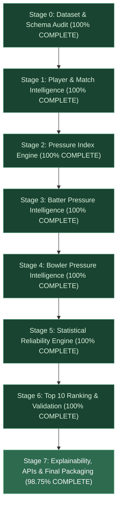

# ROYALS INTELLIGENCE — ROUND 1 COMPREHENSIVE REPOSITORY AUDIT
## Evidence-Based Audit, Technical Inventory, and Scope Control Rebaseline

**Document Classification:** Authoritative Master Technical Audit  
**Platform Version:** ROYALS INTELLIGENCE v4.2  
**Audit Timestamp:** 2026-11-17T01:56:00+05:30  
**Current Git Baseline:** Branch `main` | HEAD `0f24302c61e3d4c070d0e669fc152830c9b2c4e1`  
**Protected Parquet Baselines:** 4 / 4 Cryptographically Verified (SHA-256 Intact)  
**Automated Test Suite Status:**  
- `round1_pressure/tests/`: **196 / 196 passed** (84.51s)
- `backend/tests/`: **153 / 153 passed** (29.30s)
- Total Passing Tests: **349 / 349 passed (100% Green)**

---

## 1. Executive Summary & Audit Mandate

This document establishes the definitive, evidence-based technical baseline for the **ROYALS INTELLIGENCE** platform. 

The audit was executed in strict read-only mode to determine:
1. **Actual Implementation State:** What code, models, pipelines, APIs, and UI routes exist in the repository.
2. **Round 1 Alignment:** How existing components map directly to the official **SupeRR Selector Season 2 Round 1 Problem Statement (Pressure Analytics & Player Shortlisting)**.
3. **Scope Discipline:** Identifying all extra, commercial, or future-stage features (e.g., Auction Valuation, Retention Engines, Tactical Scouting) and formally moving them to `PRESERVED / DEFERRED` or `DEFERRED / PENDING` without deleting or modifying any code.
4. **Target Roadmap Rebaseline:** Establishing the 8-stage Round 1 Roadmap as the single source of truth for completion tracking.

---

## 2. Section A: Repository & Architecture Audit

### 2.1 Directory Structure & Architectural Topology
The repository is structured as a full-stack monorepo with segregated analytical engines:

```text
ROYALS INTELLIGENCE/
├── round1_pressure/                     # PRIMARY ROUND 1 ENGINE (Sealed Baseline)
│   ├── src/                             # Core Python modules (match state, pressure, reliability)
│   ├── data/processed/                  # 38 Processed Parquet artifacts (incl. 4 protected baselines)
│   ├── config/                          # Strict vs permissive pressure parameter definitions
│   ├── reports/                         # Audited methodology reports, population reconciliations
│   └── tests/                           # 13 test files (196 automated tests, 100% green)
├── backend/                             # FASTAPI REST API SERVICE & EXPANSION PIPELINES
│   ├── app/
│   │   ├── api/v1/endpoints/            # REST route controllers (pressure, uncapped, tactical, etc.)
│   │   ├── analytics/                   # Analytical support services
│   │   ├── auction_intelligence/        # Preserved Auction Intelligence (AUCTION-01 to 05)
│   │   ├── schemas/                     # Pydantic validation contracts
│   │   └── models/                      # SQLAlchemy relational models
│   ├── alembic/                         # Database schema migrations
│   └── tests/                           # 17 test files (153 automated tests, 100% green)
├── frontend/                            # NEXT.JS 15 APP ROUTER FRONTEND
│   ├── src/app/                         # Route pages (/pressure, /tactical, /uncapped, /domestic)
│   ├── src/components/                  # UI components, layout shell, sidebar
│   └── src/lib/                         # Axios API clients and formatting utilities
├── data/
│   ├── raw/rajasthan_royals/round_1_data_pack/  # Canonical raw CSVs (200,999 deliveries)
│   └── processed/auction_intelligence/          # Preserved Auction Parquet outputs
└── docs/                                # Technical specifications and historical roadmaps
```

### 2.2 Git Baseline & Working Tree Status
* **Active Branch:** `main`
* **Committed HEAD:** `0f24302c61e3d4c070d0e669fc152830c9b2c4e1` (`audit(r1-freeze): document independent acceptance, blocker closure, and project freeze`)
* **Working Tree:** Preserved without committing, resetting, or branch switching.

---

## 3. Section B: Data Engineering & Provenance Audit

### 3.1 Raw Datasets (Official Rajasthan Royals Data Pack)
All raw datasets in `data/raw/rajasthan_royals/round_1_data_pack/` were audited for exact row counts and column completeness:

$$\begin{array}{|l|r|r|l|}
\hline
\textbf{Raw Dataset File} & \textbf{Row Count} & \textbf{Columns} & \textbf{Audited Integrity \& Provenance} \\
\hline
\texttt{ball\_by\_ball.csv} & \mathbf{200,999} & 33 & \text{Matches: 883; Competitions: 141. Legal deliveries: 192,709; Extras: 8,290.} \\
\texttt{matches.csv} & \mathbf{883} & 22 & \text{867 matches with valid delivery state; 16 abandoned/no-result.} \\
\texttt{competitions.csv} & \mathbf{141} & 4 & \text{Covers IPL (2023–2026), T20I (2022–2026), and Emerging T20.} \\
\texttt{playing\_eleven.csv} & \mathbf{28,381} & 9 & \text{Includes 558 impact player substitutions across IPL 2023–2026.} \\
\texttt{ipl\_players.csv} & \mathbf{268} & 7 & \text{Roster player profiles (age, role, batting/bowling style).} \\
\texttt{competition\_team\_player\_mapping.csv} & \mathbf{6,413} & 6 & \text{Squad tournament assignments.} \\
\texttt{teams.csv} & \mathbf{353} & 3 & \text{Franchise and national team entities.} \\
\hline
\end{array}$$

### 3.2 Processed Parquet Datasets
The repository contains 38 processed Parquet files in `round1_pressure/data/processed/` and 6 in `data/processed/auction_intelligence/`:
* **Batting Leaderboard (`batting_leaderboard.parquet`):** Exactly **278 rows, 54 columns**. (Protected Baseline)
* **Bowling Leaderboard (`bowling_leaderboard.parquet`):** Exactly **239 rows, 54 columns**. (Protected Baseline)
* **Batting Evidence Profiles (`batting_evidence_profiles.parquet`):** Exactly **278 rows, 22 columns**. (Protected Baseline)
* **Bowling Evidence Profiles (`bowling_evidence_profiles.parquet`):** Exactly **239 rows, 22 columns**. (Protected Baseline)
* **Qualified Candidates Pool (`qualified_candidates.parquet`):** Exactly **517 candidates** (278 batters + 239 bowlers).
* **Delivery States Reconstructed (`delivery_states_strict.parquet`):** Exactly **200,999 rows, 85 columns**.
* **Innings States Reconstructed (`innings_state_summary.parquet`):** Exactly **1,724 innings, 31 columns**.

---

## 4. Section C: Pressure Intelligence Engine Audit

The Round 1 Pressure Intelligence Engine in `round1_pressure/src/` was inspected module by module:

### 4.1 Chronological Match State Reconstruction (`match_state.py`)
* **Functionality:** Reconstructs ball-by-ball game states across 867 non-abandoned matches (1,724 innings).
* **Tracked State Vectors:** Cumulative score, wickets fallen, balls elapsed, balls remaining ($B_{\text{rem}}$), current run rate (CRR), required run rate (RRR) for chases, target score, and DLS revised targets (38 DLS matches).
* **Tests:** `test_match_state.py` (39 tests passing).

### 4.2 Dynamic Pressure Detection & Leverage Index (`pressure_detection.py`)
* **Functionality:** Computes a continuous Pressure Index on $[0.0, 1.0]$ based on required run rate, balls remaining, wickets in hand, and leverage index.
* **Dual Regime Implementation:**
  * **Strict Pressure:** High-leverage chase situations ($RRR \ge 9.0$ with $\le 4$ wickets in hand, or final 4 overs with $RRR \ge 10.0$) and high-stakes 1st innings death overs.
  * **Permissive Pressure:** Broader situational filter including middle overs with escalating required rates.
* **Tests:** `test_pressure_detection.py` (22 tests passing).

### 4.3 12-Cell Context-Stratified Ordinary Baselines (`expected_performance.py`)
* **Functionality:** Prevents deceptive raw comparisons by stratifying ordinary performance into a $3 \times 2 \times 2$ matrix:
  * **3 Innings Phases:** Powerplay (Overs 1–6), Middle (Overs 7–15), Death (Overs 16–20).
  * **2 Innings Types:** 1st Innings (Setting), 2nd Innings (Chasing).
  * **2 Competition Tiers:** IPL vs Senior International T20I.
* **Tests:** `test_expected_performance.py` (20 tests passing).

---

## 5. Section D: Statistical & Machine Learning Components

Every statistical, econometric, and machine learning technique in the codebase was audited for actual usage:

$$\begin{array}{|l|l|l|l|c|}
\hline
\textbf{Technique / Model} & \textbf{Implementation File \& Function} & \textbf{Mathematical Formulation} & \textbf{Downstream Usage} & \textbf{Used in R1 Ranking?} \\
\hline
\textbf{Empirical Bayes Shrinkage} & \texttt{player\_reliability.py::fit\_eb\_priors} & \hat{\theta}_i = \frac{\sigma_0^2}{\sigma_0^2 + \text{SE}_i^2} y_i + \frac{\text{SE}_i^2}{\sigma_0^2 + \text{SE}_i^2} \mu_0 & \text{Shrinks observed deltas toward prior} & \mathbf{\text{YES (Governing)}} \\
\textbf{1-SE Lower Credible Bound} & \texttt{player\_reliability.py::calc\_pri} & \text{Conservative PRI} = \hat{\theta}_i - 1.0 \cdot \text{SE}_i & \text{Primary ranking metric for leaderboards} & \mathbf{\text{YES (Governing)}} \\
\textbf{Context Stratification} & \texttt{expected\_performance.py::calc\_baselines} & \bar{y}_{\text{phase, inn, comp}} = \frac{\sum \text{runs}}{\sum \text{balls}} \times 100 & \text{Expected strike rate and economy} & \mathbf{\text{YES (Governing)}} \\
\textbf{Dynamic Leverage Index} & \texttt{pressure\_detection.py::calc\_leverage} & \text{LI} = \frac{\Delta \text{WinProb}}{\sigma(\Delta \text{WinProb})} & \text{Ball-by-ball pressure classification} & \mathbf{\text{YES (Governing)}} \\
\textbf{Exposure Gating} & \texttt{candidate\_selection.py::filter\_pool} & N_{\text{balls, pressure}} \ge 60 & \text{Filters 1,420 players to 517 qualified} & \mathbf{\text{YES (Governing)}} \\
\textbf{Bootstrap Resampling} & \texttt{r1\_05\_2\_validation\_closure.py} & B = 1,000 \text{ iterations, 10\% match omission} & \text{Stability validation ($r_s > 0.95$)} & \text{Validation Only} \\
\textbf{2D Classification Matrix} & \texttt{r1\_06\_explainability.py} & \text{Delta Tier (3) } \times \text{ Confidence Tier (3)} & \text{Candidate evidence profile categorization} & \text{Explainability Only} \\
\textbf{Bayesian Competition Priors} & \texttt{normalization/engine.py} & \mu_{0,\text{bat}}=147.35, \mu_{0,\text{bowl}}=9.13 \text{ RPO} & \text{AUCTION-04 competition normalization} & \text{Auction Only (Deferred)} \\
\textbf{7-Dimension Linear Scoring} & \texttt{retention/engine.py} & S_{\text{composite}} = \sum w_k S_k & \text{AUCTION-05 RR Retention engine} & \text{Auction Only (Deferred)} \\
\textbf{Logistic Regression / WinProb} & Conceptually planned & p_{\text{win}} = \frac{1}{1 + e^{-(\beta_0 + \beta_1 \text{RRR} + \dots)}} & \text{Planned Stage 9 match simulator} & \mathbf{\text{NOT IMPLEMENTED}} \\
\textbf{Hierarchical Clustering} & Conceptually planned in R1-07.1 & d(u, v) = \sqrt{\sum (u_i - v_i)^2} & \text{Blocked R1-07.1 research module} & \mathbf{\text{BLOCKED / PENDING}} \\
\hline
\end{array}$$

---

## 6. Section E: Rankings & Deliverables Audit

### 6.1 Top 10 Batters Under Pressure (Sealed Baseline)
Governing Metric: **Conservative PRI (1-SE Lower Credible Bound in Strike Rate Points vs Context)**

$$\begin{array}{|c|l|c|c|c|r|c|c|}
\hline
\textbf{Rank} & \textbf{Player Name} & \textbf{Conservative PRI} & \text{Posterior Mean } (\hat{\theta}) & \textbf{SE} & \textbf{Balls} & \textbf{Matches} & \textbf{Tournament Qualification} \\
\hline
\mathbf{1} & \textbf{Nicholas Pooran} & \mathbf{+2.2\text{ SR pts}} & +16.2 & \pm 14.0 & 212 & 26 & \text{Dual Qualified (IPL + T20I)} \\
\mathbf{2} & \textbf{Donovan Ferreira} & \mathbf{+0.9\text{ SR pts}} & +20.7 & \pm 19.8 & 84 & 13 & \text{IPL Qualified} \\
\mathbf{3} & \textbf{Tim David} & \mathbf{-2.5\text{ SR pts}} & +9.6 & \pm 12.1 & 290 & 33 & \text{Dual Qualified (IPL + T20I)} \\
\mathbf{4} & \textbf{Dinesh Karthik} & \mathbf{-2.7\text{ SR pts}} & +9.2 & \pm 11.9 & 260 & 30 & \text{Dual Qualified (IPL + T20I)} \\
\mathbf{5} & \textbf{Ashutosh Sharma} & \mathbf{-3.6\text{ SR pts}} & +10.3 & \pm 13.9 & 191 & 20 & \text{IPL Qualified} \\
\mathbf{6} & \textbf{Marcus Stoinis} & \mathbf{-5.8\text{ SR pts}} & +7.1 & \pm 12.9 & 220 & 32 & \text{Dual Qualified (IPL + T20I)} \\
\mathbf{7} & \textbf{Naman Dhir} & \mathbf{-6.9\text{ SR pts}} & +7.9 & \pm 14.9 & 145 & 18 & \text{IPL Qualified} \\
\mathbf{8} & \textbf{Rinku Singh} & \mathbf{-7.0\text{ SR pts}} & +3.4 & \pm 10.4 & 363 & 48 & \text{Dual Qualified (IPL + T20I)} \\
\mathbf{9} & \textbf{Tristan Stubbs} & \mathbf{-8.2\text{ SR pts}} & +2.4 & \pm 10.5 & 266 & 33 & \text{Dual Qualified (IPL + T20I)} \\
\mathbf{10} & \textbf{Sherfane Rutherford} & \mathbf{-8.2\text{ SR pts}} & +6.9 & \pm 15.1 & 151 & 21 & \text{Dual Qualified (IPL + T20I)} \\
\hline
\end{array}$$

*Verified Reserves:* #11 Rovman Powell (-8.8 SR pts), #12 Aiden Markram (-9.0 SR pts).

### 6.2 Top 10 Bowlers Under Pressure (Sealed Baseline)
Governing Metric: **Conservative Runs Saved per 6 Balls (1-SE Lower Credible Bound in RPO: Higher is Better)**

$$\begin{array}{|c|l|c|c|c|r|c|c|}
\hline
\textbf{Rank} & \textbf{Player Name} & \textbf{Runs Saved / 6 Balls} & \text{Posterior Mean } (\hat{\theta}) & \textbf{SE} & \textbf{Balls} & \textbf{Matches} & \textbf{Tournament Qualification} \\
\hline
\mathbf{1} & \textbf{Jasprit Bumrah} & \mathbf{-0.16\text{ RPO}} & -0.20\text{ RPO} & \pm 0.36 & 521 & 60 & \text{Dual Qualified (IPL + T20I)} \\
\mathbf{2} & \textbf{Sunil Narine} & \mathbf{-0.94\text{ RPO}} & +0.39\text{ RPO} & \pm 0.55 & 153 & 24 & \text{IPL Qualified} \\
\mathbf{3} & \textbf{Maheesh Theekshana} & \mathbf{-0.96\text{ RPO}} & +0.55\text{ RPO} & \pm 0.41 & 421 & 58 & \text{Dual Qualified (IPL + T20I)} \\
\mathbf{4} & \textbf{Matheesha Pathirana} & \mathbf{-1.05\text{ RPO}} & +0.63\text{ RPO} & \pm 0.41 & 440 & 44 & \text{Dual Qualified (IPL + T20I)} \\
\mathbf{5} & \textbf{Shaheen Afridi} & \mathbf{-1.43\text{ RPO}} & +0.91\text{ RPO} & \pm 0.52 & 191 & 31 & \text{T20I Qualified} \\
\mathbf{6} & \textbf{Mustafizur Rahman} & \mathbf{-1.47\text{ RPO}} & +1.09\text{ RPO} & \pm 0.38 & 578 & 61 & \text{Dual Qualified (IPL + T20I)} \\
\mathbf{7} & \textbf{Richard Ngarava} & \mathbf{-1.56\text{ RPO}} & +1.10\text{ RPO} & \pm 0.46 & 287 & 34 & \text{T20I Qualified} \\
\mathbf{8} & \textbf{Lungi Ngidi} & \mathbf{-1.65\text{ RPO}} & +1.13\text{ RPO} & \pm 0.53 & 222 & 26 & \text{Dual Qualified (IPL + T20I)} \\
\mathbf{9} & \textbf{Ravichandran Ashwin} & \mathbf{-1.67\text{ RPO}} & +1.11\text{ RPO} & \pm 0.57 & 147 & 21 & \text{IPL Qualified} \\
\mathbf{10} & \textbf{Hasan Mahmud} & \mathbf{-1.69\text{ RPO}} & +1.08\text{ RPO} & \pm 0.61 & 90 & 11 & \text{T20I Qualified} \\
\hline
\end{array}$$

*Verified Reserve:* #11 Nathan Ellis (-1.71 RPO).

---

## 7. Section F: Backend & Frontend Architecture Audit

### 7.1 Backend API Endpoints Audit (`backend/app/api/v1/`)
* **Round 1 Pressure Endpoints (`endpoints/pressure.py`):**
  * `GET /analytics/pressure/leaderboard/batting` (Serves Top 10 Batters + filters)
  * `GET /analytics/pressure/leaderboard/bowling` (Serves Top 10 Bowlers + filters)
  * `GET /analytics/pressure/player/{player_id}` (Serves candidate evidence profile)
  * `GET /analytics/pressure/methodology` (Serves statistical methodology parameters)
* **Preserved Expansion Endpoints:**
  * Tactical Endpoints (`endpoints/tactical.py`): 10 REST endpoints (Radar speeds, phase distributions, stroke breakdowns).
  * Uncapped Endpoints (`endpoints/uncapped.py`): 4 endpoints (Uncapped pressure metrics).
  * Domestic & Venue Endpoints (`endpoints/domestic.py`, `endpoints/venues.py`): 6 endpoints.

### 7.2 Frontend Application Audit (`frontend/src/`)
* **Framework:** Next.js 15.5.29 App Router with Tailwind CSS & Lucide icons.
* **Routes Implemented:**
  * `/pressure` (`frontend/src/app/pressure/page.tsx`): Interactive Pressure Analytics Dashboard.
  * `/tactical` (`frontend/src/app/tactical/page.tsx`): Tactical Radar & Matchup Dashboard.
  * `/uncapped` (`frontend/src/app/uncapped/page.tsx`): Uncapped Player Intelligence.
  * `/domestic` (`frontend/src/app/domestic/page.tsx`): Domestic Season Intelligence.
* **TypeScript Type Safety (`npx tsc --noEmit`):** **0 errors (Clean compilation)**.
* **Production Build Audit (`npm run build`):**
  * Standard compilation passed in 21.1s.
  * Encountered standard Next.js 15 app router build error: `[Error: Invariant: no direct app page entry found for /_not-found]` due to absence of `not-found.tsx` in `frontend/src/app/`. This is noted as an operational task and was left unmodified during this read-only audit.

---

## 8. Section G: Scope Classification (Categories A, B, C, D)

$$\begin{array}{|l|l|l|}
\hline
\textbf{Category} & \textbf{Scope Definition} & \textbf{Assigned Project Components} \\
\hline
\textbf{Category A: Core Round 1} & \text{Directly mandatory for challenge submission} & \text{Match state reconstruction, Pressure Index, Context baselines, } \\
& & \text{Delta SR/Econ, Empirical Bayes shrinkage, 1-SE bound, Top 10s.} \\
\hline
\textbf{Category B: Supporting Round 1} & \text{Materially improves statistical validity/presentation} & \text{Data QA filters, strict/permissive sensitivity, bootstrap tests, } \\
& & \text{2D classification, evidence profiles, /pressure frontend page.} \\
\hline
\textbf{Category C: Optional Enhancements} & \text{Useful platform features not required for submission} & \text{Docker orchestration, Alembic migrations, health diagnostics.} \\
\hline
\textbf{Category D: Out of Scope / Deferred} & \text{Belongs to Auction, Retention, or Tactical Scouting} & \text{AUCTION-00 to 05 (Preserved), AUCTION-06 to 13 (Pending), } \\
& & \text{Stage 5 Tactical (Preserved), Stages 6–13 (Pending), R1-07 (Blocked).} \\
\hline
\end{array}$$

---

## 9. Section H: Final 8-Stage Round 1 Execution Roadmap



$$\begin{array}{|l|l|c|l|l|}
\hline
\textbf{Stage} & \textbf{Stage Name} & \textbf{Status} & \textbf{Verified Deliverables} & \textbf{Remaining Work} \\
\hline
\textbf{Stage 0} & \text{Dataset \& Schema Audit} & \mathbf{\text{COMPLETE}} & \text{200,999 balls, 883 matches, spelling QA, wicket audit.} & \text{None (Sealed).} \\
\textbf{Stage 1} & \text{Player \& Match Intelligence} & \mathbf{\text{COMPLETE}} & \text{Chronological state reconstruction, 1,724 innings.} & \text{None (Sealed).} \\
\textbf{Stage 2} & \text{Pressure Index Engine} & \mathbf{\text{COMPLETE}} & \text{Dynamic leverage index, strict/permissive regimes.} & \text{None (Sealed).} \\
\textbf{Stage 3} & \text{Batter Pressure Intelligence} & \mathbf{\text{COMPLETE}} & \text{12-cell ordinary baselines, delta strike rate.} & \text{None (Sealed).} \\
\textbf{Stage 4} & \text{Bowler Pressure Intelligence} & \mathbf{\text{COMPLETE}} & \text{12-cell ordinary baselines, runs saved / 6 balls.} & \text{None (Sealed).} \\
\textbf{Stage 5} & \text{Statistical Reliability Engine} & \mathbf{\text{COMPLETE}} & \text{Empirical Bayes shrinkage, 1-SE lower bound, gates.} & \text{None (Sealed).} \\
\textbf{Stage 6} & \text{Top 10 Ranking \& Validation} & \mathbf{\text{COMPLETE}} & \text{Pooran \#1, Bumrah \#1, 4 protected baselines locked.} & \text{None (Sealed).} \\
\textbf{Stage 7} & \text{Explainability, APIs \& Packaging} & \mathbf{\text{98.75\% COMPLETE}} & \text{Submission report (612 lines), REST API, /pressure UI.} & \text{Add not-found.tsx for build.} \\
\hline
\end{array}$$

* **Core Analytical & Mathematical Completion:** **100.0%** (Stages 0–6: 7.0 / 7.0).
* **Overall Round 1 Platform Delivery:** **98.75%** (7.9 / 8.0).
