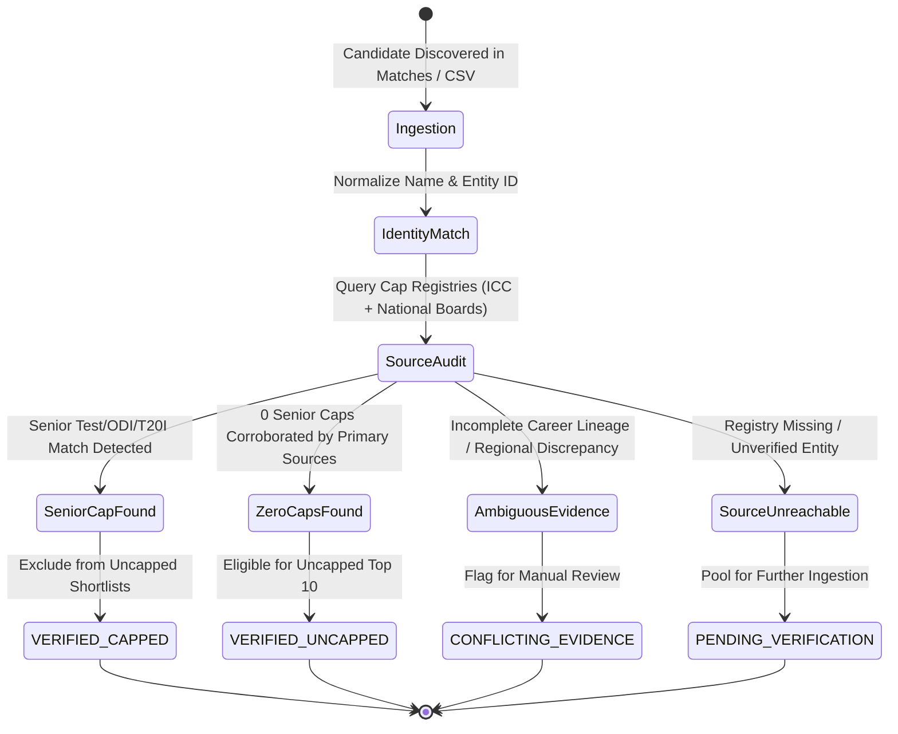
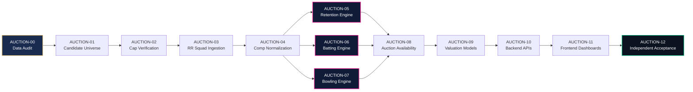

# ROYALS INTELLIGENCE — RR AUCTION & RETENTION INTELLIGENCE
## Master System Architecture Specification & Engineering Blueprint — v1.0
**Domain:** RR Auction & Retention Intelligence (Additive Bounded Context)  
**Target:** IPL 2027 Mega-Auction Strategy & Squad Retention Decision-Support Engine  
**Document Status:** AUTHORITATIVE ARCHITECTURAL STANDARD (Planning & Integration Phase)  
**Authoritative Baseline:** Checkpoint `0f24302c61e3d4c070d0e669fc152830c9b2c4e1` (`main`)  
**Deliverable Targets:** Exactly 3 RR Retentions + 10 Combined Uncapped Batters + 10 Combined Uncapped Bowlers (23 Total Slots)

---

## 1. Executive Mission & Domain Philosophy

### 1.1 Additive Expansion Principle
**RR Auction & Retention Intelligence** is an independent, additive analytical domain engineered to provide data-driven, mathematically sound decision support for Rajasthan Royals' IPL 2027 retention and auction strategy.

This domain operates as a distinct bounded context within the ROYALS INTELLIGENCE enterprise platform. In accordance with platform governance directives:
1. **Zero Disruption to Existing Assets:** No existing service, algorithm, pipeline, calculation, database model, route, or test suite belonging to Round 1 Pressure Intelligence or Stage 5 Tactical Intelligence is modified, weakened, or replaced.
2. **Strict Analytical Separation:** Existing Round 1 Conservative PRI calculations ($\text{Posterior Mean} - 1.0 \times \text{SE}$) remain the sovereign standard for the official Round 1 submission deliverables. The Auction & Retention domain formulates its own multi-dimensional decision models tailored to roster construction, wage valuation, and squad replacement economics.
3. **Evidence-Driven Integrity:** Zero synthetic player data, zero invented dates of birth, zero assumed international caps, and zero speculative auction availability. All candidate classifications are anchored in verifiable provenance.

---

## 2. Inventory of Preserved Platform Capabilities

The existing platform assets listed below are strictly preserved byte-for-byte and functionally frozen:

| Subsystem | Components & Paths | Invariant Operational State |
| :--- | :--- | :--- |
| **Round 1 Pressure Engine** | `round1_pressure/src/`, `round1_pressure/data/processed/*.parquet` | All 4 protected Parquet artifacts (`batting_leaderboard`, `bowling_leaderboard`, `batting_evidence_profiles`, `bowling_evidence_profiles`) maintain exact SHA-256 verification hashes. |
| **Stage 5 Tactical Engine** | `backend/app/analytics/dataset_cricket_intelligence.py`, `backend/app/api/v1/endpoints/tactical.py` | 9 tactical modules (Phases, Strokes, Handedness, Styles, Radar Speed, H2H, Death Overs, Player Profiles) operating across 200,999 total deliveries (192,709 legal deliveries) in 883 matches (867 with delivery logs). |
| **BCCI Uncapped Audit** | `backend/app/analytics/uncapped_pressure_intelligence.py`, `backend/app/api/v1/endpoints/uncapped.py` | Standalone BCCI eligibility registry filtering out historical capped stars (Dhoni, Bravo, Rayudu, etc.). |
| **Core Ingestion Layer** | `backend/app/acquisition/storage/raw_storage.py`, `backend/app/models/` | Async ingest pipelines, duckdb/parquet hybrid query routing, SQLAlchemy 2.0 ORM schemas. |
| **Official Documentation** | `PROJECT_ARCHITECTURE.md`, `PROJECT_ROADMAP.md`, `PROJECT_STATUS.md`, `ROUND1_GIT_STAGING_PLAN.md` | Preserved and extended additively; no previous roadmap stages or statuses modified. |

---

## 3. Domain Bounded Context & Directory Architecture

To guarantee strict isolation and zero dependency bleed into existing modules, the Auction & Retention domain is organized under a dedicated bounded context:

```text
backend/app/auction_intelligence/
├── __init__.py
├── retention/                          # MODULE A: RR Retention Decision Engine
│   ├── __init__.py
│   ├── retention_evaluator.py          # Multi-season performance, consistency, replacement difficulty
│   ├── strategic_fit.py                # RR squad balance, captaincy, tactical role centrality
│   └── valuation_risk.py               # Retention bracket economics, purse impact, injury hazard
├── batting/                            # MODULE B: Combined Uncapped Batters Intelligence
│   ├── __init__.py
│   ├── batting_evaluator.py            # Phase productivity, pace/spin splits, boundary execution
│   └── tactical_suitability.py         # Middle-overs spin attack, death finishing compatibility
├── bowling/                            # MODULE C: Combined Uncapped Bowlers Intelligence
│   ├── __init__.py
│   ├── bowling_evaluator.py            # Powerplay swing, death containment economy, dot frequency
│   └── variation_profiler.py           # Radar speed distributions, release angles, deception indices
├── eligibility/                        # Strict International Cap Certification Engine
│   ├── __init__.py
│   ├── cap_verifier.py                 # Senior Test/ODI/T20I verification (ICC + 27 national boards)
│   └── eligibility_schemas.py          # VERIFIED_UNCAPPED, VERIFIED_CAPPED, PENDING, CONFLICT
├── availability/                       # Auction Registration & NOC Tracking Engine
│   ├── __init__.py
│   ├── auction_registry.py             # Auction declaration tracking, RTM eligibility, franchise release
│   └── international_noc.py            # Bilateral series clashes, national board NOC governance
├── valuation/                          # Evidence-Based Auction Valuation Engine
│   ├── __init__.py
│   ├── bid_ceiling_model.py            # Skill-scarcity valuation, historical auction inflation bands
│   └── role_market_dynamics.py         # Premium tiering for rare archetypes (Indian pace, death finishers)
├── provenance/                         # Source Audit, Evidence Chain & Freshness
│   ├── __init__.py
│   └── evidence_ledger.py              # Cryptographic hash tracking, source URLs, verification timestamps
└── shared/                             # Internal Domain Utilities & Math
    ├── __init__.py
    ├── competition_normalizer.py       # Inter-league league-strength index (IPL, BBL, PSL, SMAT, etc.)
    └── bayesian_shrinkage.py           # Independent small-sample regularizer for auction metrics

backend/app/schemas/auction/            # Dedicated Pydantic v2 Contract Schemas
├── __init__.py
├── retention.py
├── uncapped_batting.py
├── uncapped_bowling.py
├── eligibility.py
└── availability.py

backend/app/api/v1/endpoints/auction/   # Dedicated FastAPI Router Layer
├── __init__.py
├── router.py                           # Master router prefix: /api/v1/auction
├── retention.py                        # /retention endpoints
├── uncapped_batters.py                 # /uncapped/batters endpoints
├── uncapped_bowlers.py                 # /uncapped/bowlers endpoints
└── verification.py                     # /eligibility & /availability endpoints

frontend/src/app/auction/               # Dedicated Next.js 15 App Router Frontend
├── layout.tsx                          # Sub-navigation shell & breadcrumbs
├── page.tsx                            # Auction Intelligence Hub Overview
├── retention/
│   └── page.tsx                        # Module A: Exactly 3 RR Retention Recommendations
├── uncapped-batters/
│   └── page.tsx                        # Module B: Top 10 Combined Uncapped Batters
└── uncapped-bowlers/
    └── page.tsx                        # Module C: Top 10 Combined Uncapped Bowlers
```

---

## 4. Source Data Inspection: `ipl_players.csv`

### 4.1 Dataset Profiling & Verification
The supplied reference dataset located at `data/raw/rajasthan_royals/round_1_data_pack/ipl_players.csv` was forensically analyzed in read-only mode:

* **File Size:** 23,561 bytes | **Total Rows:** 268 | **Columns:** 7
* **Schema Definition:**
  - `Team` (string): Franchise association across all 10 IPL franchises.
  - `Name` (string): Full player name (267 unique names).
  - `Age` (int64): Integer player age as of current reference cycle (Min: 15, Median: 28, Max: 45).
  - `Role` (string): Primary playing classification (`Bowler`: 104, `All-rounder`: 84, `Batter`: 45, `Wicketkeeper-Batter`: 35).
  - `Batting_Style` (string): Handedness (`Right-handed`, `Left-handed`).
  - `Bowling_Style` (string): Delivery action (32 nulls, corresponding strictly to pure specialist batters and wicketkeepers).
  - `Spin_Type` (string): Spin taxonomy or `None (Pace)` (32 nulls, consistent with specialist batters).

### 4.2 Franchise Roster Distribution
The 268 records are distributed across exactly 10 franchises:
* Chennai Super Kings: 29
* Mumbai Indians: 29
* Kolkata Knight Riders: 28
* **Rajasthan Royals: 27** (Exact reconciled breakdown: 12 Bowlers, 6 All-rounders, 5 Batters, 4 Wicketkeeper-Batters; Total Batting/Keeper Pool: 9)
* Sunrisers Hyderabad: 27
* Royal Challengers Bengaluru: 26
* Delhi Capitals: 26
* Lucknow Super Giants: 26
* Punjab Kings: 25
* Gujarat Titans: 25

### 4.3 Data Anomalies & Semantic Interpretation
1. **Temporal Horizon (Post-2025/2026 Roster Reality):**
   - The file captures post-2025 mega-auction roster states:
     - Jos Buttler is registered under Gujarat Titans (Age 36).
     - Yuzvendra Chahal is registered under Punjab Kings (Age 36).
     - Ravindra Jadeja (Age 37) and Sam Curran (Age 28) are registered under Rajasthan Royals.
     - Vaibhav Sooryavanshi is registered under Rajasthan Royals (Age 15).
     - MS Dhoni is registered under Chennai Super Kings (Age 45).
2. **Duplicate Entity Detection:**
   - Exact duplicate record: `Ravi Bishnoi` is listed twice in the file:
     - Row 179: `Rajasthan Royals` (Age 26, Bowler)
     - Row 261: `Lucknow Super Giants` (Age 26, Bowler)
   - **Resolution Policy:** The engine must enforce unique player deduplication and reconcile current squad membership against official IPL retention circulars rather than treating CSV presence as definitive contract proof.
3. **Absence of Auction Registration & Cap Status:**
   - The file provides neither senior international cap flags nor auction availability declarations. It serves strictly as a roster reference dataset.

---

## 5. Module A — RR Retention Intelligence Methodology (Exactly 3 Recommendations)

### 5.1 Objective & Policy Constraints
Module A evaluates the 27 registered players of the Rajasthan Royals squad to determine the **three optimal retention choices** for IPL 2027.
* **Zero Role Quota:** The engine permits any combination (e.g. 2 batters + 1 bowler, 3 batters, 2 all-rounders + 1 keeper) based strictly on objective composite value.
* **Fail-Safe Mechanism:** If data volume or reliability is insufficient to separate candidates, the engine explicitly outputs `INSUFFICIENT_EVIDENCE_FOR_RETENTION_SLOT` rather than forcing an arbitrary choice.

### 5.2 The 14-Dimension Retention Composite Index (RCI)
Candidates are evaluated across 14 normalized dimensions:

$$\text{RCI}_i = \sum_{k=1}^{14} w_k \cdot z_{ik} - \text{Penalty}_{\text{Availability}}(i)$$

1. **Overall IPL Performance ($z_1$):** True-average, phase-normalized strike rate or economy over multi-season IPL tenure.
2. **Recent IPL Performance ($z_2$):** Weighted exponential decay favoring the two most recent IPL seasons ($t-1$ weighted $0.6$, $t-2$ weighted $0.3$, earlier weighted $0.1$).
3. **Multi-Season Consistency ($z_3$):** Coefficient of variation across match-by-match performances; penalizes boom-or-bust variance.
4. **Age & Future Potential Horizon ($z_4$):** Career longevity index based on age curve modeling for specific skill archetypes (peak window 24–29 for fast bowlers, 25–31 for batters, 26–33 for spinners).
5. **Tactical Role Centrality ($z_5$):** Scarcity of primary role in the modern T20 meta (e.g., left-arm death pace, 150+ SR middle-overs spin basher).
6. **Batting Volume & Efficiency ($z_6$):** Boundary execution percentage, dot-ball avoidance, and pressure strike rate delta.
7. **Bowling Containment & Wickets ($z_7$):** True economy rate delta, strike rate, and death-over wicket share.
8. **Match-Winning Leverage Impact ($z_8$):** High-leverage win probability added (WPA) or Conservative PRI in clutch match states.
9. **Pressure Performance ($z_9$):** Bayesian posterior performance under strict match-pressure conditions.
10. **Replacement Market Difficulty ($z_{10}$):** Estimated auction acquisition cost and talent scarcity for equivalent capability in the open pool.
11. **Squad Balance Synergy ($z_{11}$):** Team structure fit (batting depth preservation, bowling attack diversity: left/right arm balance).
12. **Leadership & Strategic Centrality ($z_{12}$):** Captaincy, tactical on-field decision-making, core franchise identity.
13. **Injury & Availability Hazard ($z_{13}$):** Documented workload restrictions, national team duty clashes, chronic injury downtime.
14. **Expected Retention Bracket Value ($z_{14}$):** Salary cap efficiency (matching candidate true worth against mandatory IPL retention deduction brackets, e.g., ₹18 Cr, ₹14 Cr, ₹11 Cr).

### 5.3 Candidate Output Contract (Module A)
For each of the exactly 3 recommended retentions, the engine exports:
* **Rank** (1, 2, 3) & **Player Name**
* **Primary Role & Bowling/Batting Attributes**
* **Retention Priority Tier** (`CRITICAL_FRANCHISE_PILLAR`, `HIGH_PRIORITY_ASSET`)
* **Multi-Season Statistical Evidence** (Runs, Wickets, SR, Economy, True Deltas)
* **Recent Season Form Trajectory** (Trendline and form index)
* **Strategic & Squad-Fit Analysis** (Role uniqueness, batting order anchor/finisher)
* **Replacement Difficulty Score** (1–10 scale based on open market depth)
* **Identified Risk Factors** (Age curve inflection, workload, historical injury periods)
* **Statistical Confidence Level** (High, Medium, Low with credible interval width)
* **Data Provenance Ledger** (Source IDs, match count, delivery sample size)

---

## 6. Module B — Combined Uncapped Batters Intelligence Methodology (Top 10)

### 6.1 Objective & Policy Constraints
Module B delivers **ONE unified Top 10** containing the highest-impact uncapped batters across Indian domestic competitions and overseas leagues.
* **Unified Shortlist:** Indian and overseas candidates are ranked on a single objective leaderboard without artificial nationality quotas.
* **Zero Duplicates:** A player cannot appear multiple times in the Top 10.
* **Strict Gate:** Every candidate must possess `VERIFIED_UNCAPPED` certification.

### 6.2 The Uncapped Batting Valuation Model (UBVM)
Raw averages and strike rates from differing tournaments cannot be compared directly. The engine applies an inter-competition normalization framework:

$$\text{UBVM}_i = \left( \alpha \cdot \text{TrueSR}_i^* + \beta \cdot \text{TrueAvg}_i^* + \gamma \cdot \text{BoundaryEff}_i^* \right) \cdot \text{CompetitionQualityFactor}(C)$$

Where:
* $\text{TrueSR}_i^*$ and $\text{TrueAvg}_i^*$ are Bayesian shrunk deviations from context-stratified baselines (Innings Phase $\times$ Match Tier).
* $\text{BoundaryEff}_i^*$ measures boundary percentage in high-leverage overs (Overs 16–20 and Overs 1–6).
* **Competition Quality Factor (CQF):** Calibrated multi-tier weighting:
  - IPL matches: $1.00$
  - Top Overseas Leagues (BBL, SA20, Hundred, CPL): $0.85$–$0.90$
  - Indian Domestic T20 (Syed Mushtaq Ali Trophy): $0.78$
  - Regional T20 Leagues (UP T20, TNPL, Maharaja T20): $0.62$
  - First-Class / List A: Contextual priors only

### 6.3 Evaluation Vectors:
1. Batting Average & Median Innings Contribution
2. Context-Adjusted Strike Rate (vs league mean in same match phase)
3. Total Production Volume (Deliveries faced and runs scored)
4. Phase Specialization (Powerplay boundary rate, Middle spin strike rate, Death finishing execution)
5. Pace vs Spin Differential (SR and dismissal rate against 140+ kph pace vs wrist-spin)
6. Pressure-Handling Capability (Empirical performance when required run rate $\ge 10.0$ or wickets $\le 3$)
7. RR Tactical Suitability (Alignment with RR middle-order power-hitting or opening requirements)
8. Estimated Auction Bid Ceiling Range (₹ Cr bracket supported by talent scarcity)

---

## 7. Module C — Combined Uncapped Bowlers Intelligence Methodology (Top 10)

### 7.1 Objective & Policy Constraints
Module C delivers **ONE unified Top 10** containing the highest-impact uncapped bowlers across Indian domestic and overseas cricket.
* **Unified Shortlist:** Combined ranking of Indian and overseas candidates.
* **Role Inclusivity:** Pure bowlers and bowling all-rounders evaluated on bowling contribution.
* **Zero Duplicates:** Unique player constraint strictly enforced.

### 7.2 The Uncapped Bowling Valuation Model (UBowVM)
Bowling effectiveness is evaluated using a phase-stratified expected run prevention and wicket probability model:

$$\text{UBowVM}_i = \left( w_{\text{PP}} \cdot \text{Score}_{\text{PP}} + w_{\text{Mid}} \cdot \text{Score}_{\text{Mid}} + w_{\text{Death}} \cdot \text{Score}_{\text{Death}} \right) \cdot \text{CQF} \cdot \text{ReliabilityShrinkage}(n)$$

Where:
* **Powerplay (Overs 1–6):** Heavy weight on dot-ball percentage ($\ge 50\%$) and early wickets with the new ball.
* **Middle Overs (Overs 7–15):** Heavy weight on economy control ($\le 7.50$) and breaking partnerships.
* **Death Overs (Overs 16–20):** Heavy weight on boundary containment ($\le 16\%$) and yorker/slower-ball execution.
* **Pace & Radar Telemetry:** For pace bowlers, evaluation incorporates radar speed distributions from the data pack (mean speed $\ge 138$ kph, top speed $\ge 145$ kph).
* **Spin Archetype Modeling:** Left-arm wrist spin, leg-spin, and mystery variations weighted for skill scarcity in auction dynamics.

---

## 8. Strict International Cap Certification Engine

### 8.1 The Sovereign Uncapped Standard
A player is certified as `VERIFIED_UNCAPPED` **if and only if** they have accumulated exactly zero appearances in senior men's international cricket:
* 0 Men's Test Caps
* 0 Men's One-Day International (ODI) Caps
* 0 Men's Twenty20 International (T20I) Caps

### 8.2 Strict Clarifications & Invariant Boundaries:
1. **IPL & Franchise Matches:** Playing in the IPL, BBL, SA20, or PSL **does not constitute an international cap**.
2. **Domestic Cricket:** First-class (Ranji Trophy, Sheffield Shield), List A (Vijay Hazare), and domestic T20 (SMAT) **do not constitute international caps**.
3. **Under-19 International Cricket:** Representing India U19 or an overseas U19 side at the ICC U19 World Cup **is NOT a senior international cap**. A player like Vaibhav Sooryavanshi (Age 15, India U19) remains strictly **uncapped**.
4. **Historical Cap Boundary:** A player who played even a single T20I or ODI a decade ago (e.g. Robin Uthappa, Nathan Bracken, Jaydev Unadkat) is **permanently classified as CAPPED** under this project definition, regardless of recent absence from international cricket.

### 8.3 Certification Lifecycle & States:



### 8.4 Authoritative Source Hierarchy
Verification executes through a formalized, immutable source hierarchy:
1. **Tier 1 (Official Governing Bodies):** ICC Official Player Registry, BCCI Central Player Database, Cricket Australia, ECB, Cricket South Africa.
2. **Tier 2 (Certified Match Records):** Official competition scorecards, Cricsheet Open match lineage registers.
3. **Tier 3 (Authoritative Historical Archives):** ESPNcricinfo canonical player records, CricketArchive authenticated profiles.
4. **Unacceptable Proof:** Absence of a name in an arbitrary CSV table is **strictly rejected as cap proof**.

---

## 9. Auction Availability, Registration & Valuation Architecture

### 9.1 Availability Verification Protocol
A player's auction availability cannot be deduced from squad membership alone. The availability engine enforces strict separation across six distinct metadata fields:
1. `historical_franchise_association`: Prior IPL team memberships.
2. `current_squad_membership`: Active 2025/2026 contract status.
3. `auction_registration_status`: Explicit confirmation of registration for the IPL 2027 Auction cycle (`REGISTERED`, `UNREGISTERED`, `PENDING_ANNOUNCEMENT`).
4. `release_status`: Official retention or release by incumbent franchise (`RETAINED`, `RELEASED`, `TRADED`, `UNKNOWN`).
5. `noc_availability_status`: Full or partial season clearance from home cricket board (`FULL_SEASON_NOC`, `PARTIAL_NOC`, `NO_NOC`, `UNVERIFIED`).
6. `eligibility_certification`: International cap classification (`VERIFIED_UNCAPPED`, `VERIFIED_CAPPED`).

### 9.2 Evidence-Based Valuation Framework
The valuation engine models expected auction bidding bands based on:
* **Historical Wage Trends:** Prior auction clearing prices for identical skill archetypes (e.g. Indian 140kph+ uncapped pacers commanding ₹4–8 Cr, specialist uncapped domestic finishers commanding ₹2–5 Cr).
* **Supply-Demand Elasticity:** Volume of verified high-performing candidates available at the auction table.
* **Bid Ceiling Recommendation:** A mathematically defined upper limit beyond which bidding yields negative expected value for RR purse allocation.
* **Strict Anti-Speculation Rule:** The platform never presents an estimated valuation as an official contracted price.

---

## 10. Backend API Specifications & Contracts

The new domain exposes independent read-only REST endpoints mounted under `/api/v1/auction`:

### 10.1 Retention API Family
* `GET /api/v1/auction/retention`
  - **Description:** Returns the official 3 Rajasthan Royals retention recommendations with full multi-dimensional evaluation.
  - **Response Model:** `RRRetentionResponse` (contains `retention_slots: List[RRRetentionItem]`, `squad_evaluated_count: int`, `methodology_version: str`, `audit_date: str`).
* `GET /api/v1/auction/retention/{player_id}`
  - **Description:** Returns granular retention dossier for a specific RR squad member.
* `GET /api/v1/auction/retention/methodology`
  - **Description:** Exports mathematical formulation of the 14-dimension RCI and sensitivity audit.

### 10.2 Combined Uncapped Batting API Family
* `GET /api/v1/auction/uncapped/batters`
  - **Query Params:** `limit` (default 10), `min_balls` (default 100), `include_overseas` (default true).
  - **Description:** Returns the unified Top 10 Uncapped Batters with phase splits, pace/spin metrics, and eligibility dossiers.
  - **Response Model:** `UncappedBattingResponse`.
* `GET /api/v1/auction/uncapped/batters/{player_id}`
  - **Description:** Detailed tactical and valuation breakdown for an individual uncapped batter.

### 10.3 Combined Uncapped Bowling API Family
* `GET /api/v1/auction/uncapped/bowlers`
  - **Query Params:** `limit` (default 10), `min_overs` (default 20), `include_overseas` (default true).
  - **Description:** Returns the unified Top 10 Uncapped Bowlers with phase containment, radar telemetry, and eligibility dossiers.
  - **Response Model:** `UncappedBowlingResponse`.
* `GET /api/v1/auction/uncapped/bowlers/{player_id}`
  - **Description:** Granular bowling variation breakdown and pitch compatibility.

### 10.4 Eligibility & Provenance API Family
* `GET /api/v1/auction/eligibility/{player_id}`
  - **Description:** Returns cryptographic provenance, source citations, and senior cap verification history for any candidate.
* `GET /api/v1/auction/availability/{player_id}`
  - **Description:** Returns auction declaration status, NOC flags, and release audit.

---

## 11. Frontend Integration & UI/UX Specification

### 11.1 Sidebar Navigation Structure
A dedicated parent navigation category is integrated additively into `frontend/src/components/layout/Sidebar.tsx` without disturbing existing routes:

```text
├── EXECUTIVE OVERVIEW (/)
├── ROUND 1 FLAGSHIP
│   ├── Pressure Intelligence (/pressure)
│   └── Tactical Intelligence (/tactical)
│   └── Uncapped Domestic (/uncapped)
├── RR AUCTION INTELLIGENCE [NEW]
│   ├── Retention Intelligence (Top 3) (/auction/retention)
│   ├── Uncapped Batters (Top 10) (/auction/uncapped-batters)
│   └── Uncapped Bowlers (Top 10) (/auction/uncapped-bowlers)
└── DATA & FOUNDATION
    ├── Data Acquisition (/acquisition)
    ├── Domestic & Matches (/domestic)
    └── Venue & Pitch (/venues)
```

### 11.2 UI Design Principles:
1. **Design System Harmony:** Utilizes ROYALS INTELLIGENCE signature tokens: `#101C37` (Midnight Royal), `#E91E8F` (Royals Pink), `#D6B56D` (Championship Gold), and `#1A2B50` (Navy Border).
2. **Unified Player Cards:** Uncapped candidate cards prominently display nationality badges (e.g. `[IND]` or `[OS - SA]`), verified uncapped tags, role classifications, and valuation bands.
3. **Evidence Dossier Drawers:** Clicking any candidate opens a comprehensive evidence panel containing phase radar charts, pace/spin splits, source links, and confidence intervals.

---

## 12. Stage-Wise Implementation Roadmap (AUCTION-00 to AUCTION-12)

The execution of this domain is governed by 13 dedicated, sequential stages. Every stage is strictly gated and initialized in `PLANNED` / `NOT STARTED` status:



### Detailed Stage Breakdown:

* **AUCTION-00 — Architecture, Data and Source Audit:**
  - *Objective:* Complete forensic audit of supplied datasets, source APIs, and verification pipelines.
  - *Status:* **PLANNED** | *Gate:* User review & approval of architecture blueprint.
* **AUCTION-01 — Player Identity and Candidate Universe:**
  - *Objective:* Establish canonical player deduplication across `ipl_players.csv`, `competition_team_player_mapping.csv`, and overseas league rosters.
  - *Status:* **NOT STARTED**
* **AUCTION-02 — Senior International Eligibility Verification:**
  - *Objective:* Build the automated cap verification pipeline querying ICC and national board debut registers.
  - *Status:* **NOT STARTED**
* **AUCTION-03 — Current RR Squad and Retention Candidate Intelligence:**
  - *Objective:* Profile all 27 Rajasthan Royals players across multi-season metrics, roles, and contract windows.
  - *Status:* **NOT STARTED**
* **AUCTION-04 — Historical Performance and Competition Normalization:**
  - *Objective:* Formulate the inter-competition quality factor (CQF) and calibrate Bayesian prior baselines.
  - *Status:* **NOT STARTED**
* **AUCTION-05 — Retention Ranking Engine:**
  - *Objective:* Implement the 14-dimension RCI mathematical engine to produce exactly 3 retention recommendations.
  - *Status:* **NOT STARTED**
* **AUCTION-06 — Uncapped Batting Intelligence Engine:**
  - *Objective:* Construct the UBVM pipeline and generate the unified Top 10 Uncapped Batters.
  - *Status:* **NOT STARTED**
* **AUCTION-07 — Uncapped Bowling Intelligence Engine:**
  - *Objective:* Construct the UBowVM pipeline and generate the unified Top 10 Uncapped Bowlers.
  - *Status:* **NOT STARTED**
* **AUCTION-08 — Auction Availability and Registration Verification:**
  - *Objective:* Implement registration tracking, NOC clearance checks, and franchise release auditing.
  - *Status:* **NOT STARTED**
* **AUCTION-09 — Auction Valuation and Squad Suitability:**
  - *Objective:* Model bid ceiling dynamics, wage inflation bands, and tactical fit with RR 2027 squad vacancies.
  - *Status:* **NOT STARTED**
* **AUCTION-10 — Backend APIs and Evidence Provenance:**
  - *Objective:* Expose FastAPI endpoint families under `/api/v1/auction` with Pydantic v2 schemas.
  - *Status:* **NOT STARTED**
* **AUCTION-11 — Frontend Integration and Player Profiles:**
  - *Objective:* Build responsive Next.js 15 dashboards under `/auction/retention`, `/auction/uncapped-batters`, and `/auction/uncapped-bowlers`.
  - *Status:* **NOT STARTED**
* **AUCTION-12 — Independent Validation, Testing and Acceptance:**
  - *Objective:* Execute comprehensive automated unit, integration, and statistical perturbation tests with zero regressions.
  - *Status:* **NOT STARTED**

---

## 13. Acceptance Criteria for All Three Outputs

1. **Module A — RR Retention Intelligence:**
   - [ ] Exactly 3 players recommended from the active 27-member Rajasthan Royals squad.
   - [ ] Recommendation is role-unconstrained (zero artificial role quotas).
   - [ ] Every candidate accompanied by complete 14-dimension RCI evidence, recent form trajectory, strategic importance, replacement difficulty score, and risk profile.
   - [ ] Mathematical sensitivity analysis demonstrates stability of top-3 selection under reasonable weight perturbations.
2. **Module B — Combined Uncapped Batters Intelligence:**
   - [ ] Exactly 10 players ranked on a single, unified leaderboard.
   - [ ] Both Indian and overseas uncapped batters evaluated together.
   - [ ] 100% of candidates hold verified `VERIFIED_UNCAPPED` certification (zero senior international caps across Test, ODI, T20I).
   - [ ] Zero duplicate players within the Top 10.
   - [ ] Includes phase splits (Powerplay, Middle, Death), pace/spin splits, competition normalization, and auction valuation bands.
3. **Module C — Combined Uncapped Bowlers Intelligence:**
   - [ ] Exactly 10 players ranked on a single, unified leaderboard.
   - [ ] Both Indian and overseas uncapped bowlers evaluated together.
   - [ ] 100% of candidates hold verified `VERIFIED_UNCAPPED` certification.
   - [ ] Zero duplicate players within the Top 10.
   - [ ] Includes phase splits, dot-ball percentages, radar speed telemetry, bowling style analysis, and auction valuation bands.
4. **Platform Non-Regression:**
   - [ ] All 4 protected Parquet hashes remain unchanged.
   - [ ] 100% of existing Round 1 Pressure and Stage 5 Tactical tests continue to pass.
   - [ ] Zero changes to existing API routes or Round 1 competition deliverables.

---

## 14. Document Governance & Traceability

* **Document Location:** `docs/RR_AUCTION_RETENTION_INTELLIGENCE_ARCHITECTURE.md`
* **Governing Standard:** ROYALS INTELLIGENCE Architecture Expansion Standard v1.0
* **Review Gate:** Requires explicit user sign-off prior to triggering AUCTION-00 implementation.
